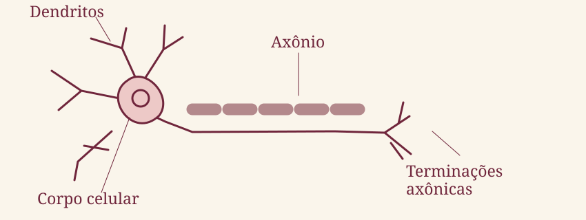

---
{
  "id": "estrutura-do-neuronio",
  "title": "Estrutura do neurônio",
  "summary": "Conheça as partes de um neurônio e como elas participam da comunicação.",
  "date": "2026-10-14",
  "instagram": "",
  "art": "neuron",
  "featured": true,
  "related": [
    "lobos-cerebrais"
  ]
}
---

## O que é um neurônio?

É uma célula do sistema nervoso especializada em receber e transmitir sinais.

## As principais partes

- **Dendritos:** prolongamentos que recebem muitos dos sinais de outras células.
- **Corpo celular:** contém o núcleo e estruturas necessárias à manutenção da célula.
- **Axônio:** prolongamento pelo qual o sinal pode se propagar.
- **Terminações axônicas:** participam da comunicação com outras células.

## Como a mensagem passa?

Em muitas sinapses, a atividade elétrica do neurônio leva à liberação de neurotransmissores. Eles podem atuar na célula seguinte.

## Para guardar no caderno

> Os neurônios trabalham em redes. As células da glia também participam do funcionamento do sistema nervoso.

## Para aprofundar

- Sinapses químicas e elétricas.
- Mielina e condução do sinal.
- Células da glia.

## Referências

- [NICHD — What are the parts of the nervous system?](https://www.nichd.nih.gov/health/topics/neuro/conditioninfo/parts)
