# Fundamentals of Neuroscience, Part 1: The Electrical Properties of the Neuron [Fundamentos de Neurociência, Parte 1: As Propriedades Elétricas do Neurônio]

## Introduction to MCB80.1x
 In this course, we will study these electrical properties in individual neurons, building up a foundation for understanding the fundamental function of the nervous system. [Neste curso, estudaremos essas propriedades elétricas em neurônios individuais, estabelecendo uma base para a compreensão da função fundamental do sistema nervoso.]

---

**Summary in English**

This course explores how individual neurons generate electrical signals. Understanding a single neuron's membrane and ion movements provides a foundation for understanding communication throughout the nervous system.

**In simple words:** before studying how the brain works as a network, we study how one nerve cell produces electrical signals.

## Lesson 1: The Resting Potential [O Potencial de Repouso]

**Summary in English**

The resting potential is the voltage across a neuron's membrane when it is not actively signaling. This lesson connects basic electricity, ion movement, and membrane properties to explain how that voltage arises.

**Key question:** how can a cell maintain a voltage difference between its inside and outside?

### Introduction to Lesson 1: The Resting Potential
We begin out study of the nervous system focusing on a single neuron. As we will see, electricity is the fundamental method by which neuros can communicate with one another, and thus *[assim]* an understanding of the electrical properties of the neuron is vital in order to understand the nervous system.

In this lesson we turn our focus to a neuron ‘at rest,’ meaning a neuron that is currently not involved in any active electrical signalling. Resting neurons have unique properties, including a voltage difference across their membrane that is called the ‘resting potential.’ 
Deviations from this 'resting potential' are how electrical signaling in neurons occurs. *[É por meio de desvios desse "potencial de repouso" que ocorre a sinalização elétrica nos neurônios.]*

For this reason, it is crucially important to understand what this resting potential is, how it is established, and how to calculate it ourselves.

**Summary in English**

A resting neuron still has a membrane voltage. Electrical signals involve changes in this voltage, so the resting potential is the starting point for understanding neuronal signaling. “At rest” does not mean that ions stop moving or that the cell stops using energy.

#### Lesson 1 Highlights

**Summary in English**

The lesson builds a sequence of ideas: bioelectricity → voltage → membrane potential → diffusion and electrostatic forces → electrochemical equilibrium. Together, these concepts explain why ion movement can produce a stable voltage across a membrane.

##### The History of Bioelectricity
In your daily life, you likely interact with electricity in many forms. For example, both lightning storms and static cling *[grudar]* in a clothes dryer are a result of static electricity. Electronic devices are charged by electric currents. Just like these non-living examples, living things obey *[obedecer]*  the laws of physics that govern electricity.

One defining feature of the nervous system is the use of electricity for communication between cells. So, before we begin an in depth study of neurons and the brain, we must first understand a bit about electricity and how it relates to neurons!

- Notes in Portuguese
Para entender a eletricidade precisamos voltar no tempo para o século XVIII (18) em Bolonha, Itália. **Luigi Galvani** era um renomado médico, físico e filósofo que vivia ali.

Em 1771, enquanto Galvani dissecava um sapo, o seu assistente tocou um nervo no sapo com o bisturi de metal que havia acumulado uma carga estática, fazendo com que a perna do sapo se movesse. Ele acreditava que havia um fluido elétrico animal.

Alessandro Volta, um físico e contemporâneo de Galvani, repetiu o experimento mas duvidada da existência de um fluido elétrico intrínseco aos animais. Volta desenvolveu a primeira bateria elétrica da história (em 1799, mas publicada em 1800), provando que uma eletricidade semelhante poderia gerar fora de um ser vivo. 

Volta, que era rival de Galvani, criou o termo galvanismo para se referir aos fenômenos elétricos em criaturas vivas
> "Galvani's voltaic pile" (ou pilha voltaica de Galvani) refere-se a uma confusão histórica comum entre dois grandes cientistas italianos: Luigi Galvani e Alessandro Volta.

**Summary in English**

- Luigi Galvani studied how electrical stimulation could make a frog's muscles contract, linking electricity to nerve and muscle function.
- Alessandro Volta questioned Galvani's explanation and developed the voltaic pile, an early battery announced in 1800.
- Their disagreement helped establish the study of bioelectricity: electrical phenomena in living organisms.
- Modern neuroscience explains neuronal electrical signals through the movement of charged ions across cell membranes.

**Historical clarification:** the voltaic pile was Volta's invention. Galvani published his major account of animal electricity in 1791; the famous frog experiments are commonly associated with the 1780s.

**Further reading:** [Galvani's original 1791 publication — Smithsonian Libraries](https://library.si.edu/digital-library/book/aloysiigalvanid00galv).

##### Voltage

To understand the electrical properties of the neuron, we first need to understand the basic concepts, components, and vocabulary of electricity. By the end of this lesson, you should be able to answer the following questions:

1. How do same and opposite charges interact?
2. What is voltage? How is voltage related to electrical potential?

Before we dive into the resting potential, we’re going to take a brief detour *[breve desvio]*  into the physics of electricity. 

Specifically, we’ll define voltage in a *bit more depth* *[pouco mais de profundidade.]*

*Whereas [Enquanto]* current can tell us the rate of charge flow, voltage helps us to understand the forces behind that flow.

Voltage is the difference in electrical potential between two points.

To understand electrical potential, we can compare it to other potentials in physics which are more familiar. 

For example, the gravitational potential of a ball at the top of a hill tells us about the energy *released* *[liberada]*  when the ball starts to roll down, and additionally tells us that the ball rolls down *instead [em vez]* of up. 

This potential is generated by the gravitational force between objects: the ball and the earth. 

Similarly, the electrical potential helps us describe the strength and direction of the forces that motivate electrical charge flow, based on electrostatic forces between charged objects.

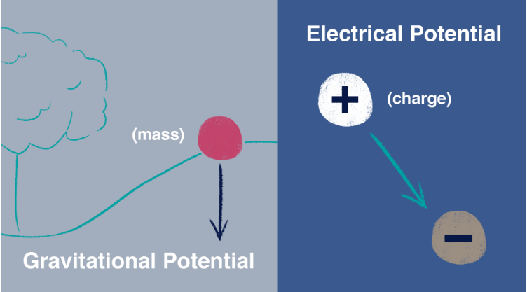

To better understand electrical potential, we need to define electrostatic force. This force describes the attraction or repulsion between charged particles (ions), which can have positive (+) or negative (–) charges. They obey simple rules: opposite charges (+ and –) attract, while like charges (+ and +, or – and –) repel. 

> Basicamente:
> Força Eletroestatica > diferentes (+ e -) se atraem, e iguais (+ e +, ou, - e -) se repelem

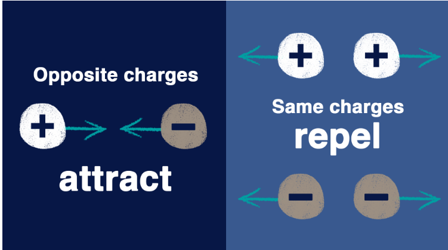

With electrostatic forces, we can now understand electrical potential. When there exists a difference in charge between two points in space, A and B, for example where A is more positive than B, an ion will have the potential to move *towards [em direção]* A or B depending on its charge.

In the example below, the potential created by A and B would cause a positively charged ion to move towards B, the more negative charge. A negatively charged ion would move towards A, the more positive charge. Voltage tells us the strength of this potential difference, and is measured in volts (V).

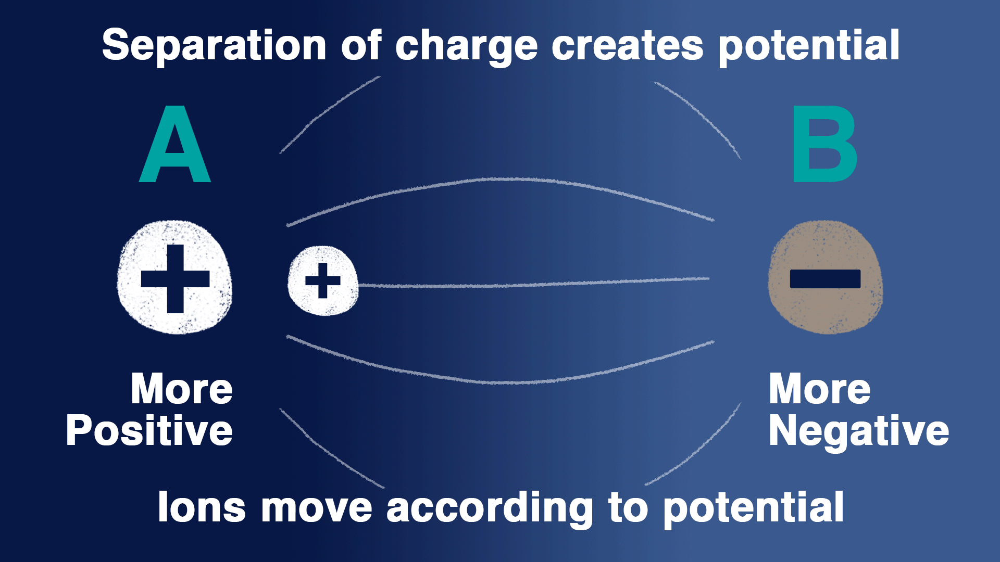

In neuroscience, the relevant points in space are the inside and the outside of a cell, which are separated by a membrane that is impermeable to charged particles. Ions cannot flow across this membrane without the help of channels or *pumps [bombas]*.

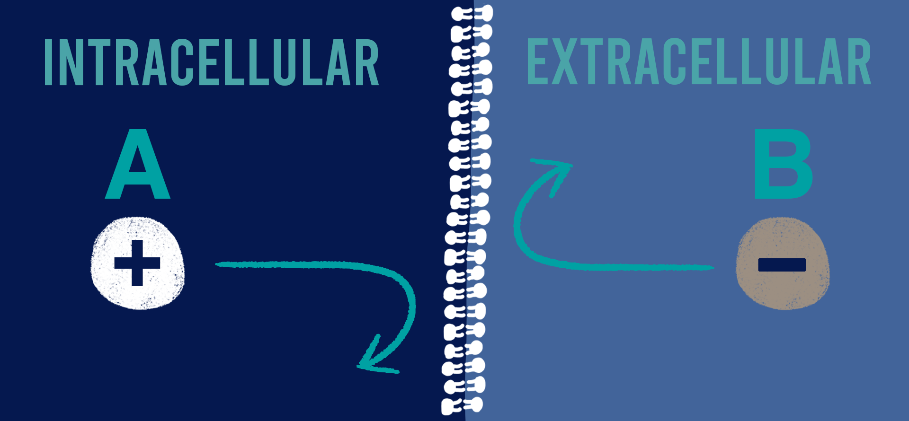

Ions can move through membrane channels and form a charge difference between these two compartments, resulting in a potential (or voltage) across the membrane. 

The impermeability of the membrane allows this voltage to be *maintained [mantida]*. 

This is similar to the *build-up [acumulação]* of charge across a capacitor in an electrical circuit. In future lessons, we'll see how exactly the movement of ions causes this voltage to form.

Voltage is a relative measurement, and neuroscientists always use the outside of the cell as the ‘ground’ or reference point to measure the voltage across the membrane. 

For example, if the inside of the cell is 50 mV more negative compared to the outside of the cell, we would report the voltage as –50 mV.

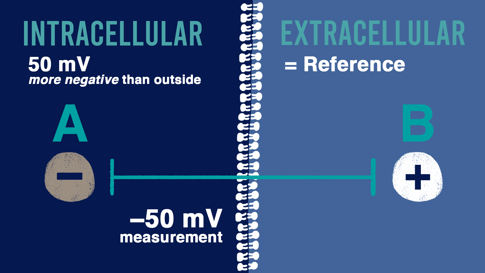

- **Question 1**

A difference in electrical potential between two point is called: **voltage**

This difference is measured in: **volts**

- **Question 2**

In neuroscience, the voltage across a membrane is measured relative to: **The outside of the cell**

---

**Summary in English**

- **Electrostatic force:** opposite charges attract; like charges repel.
- **Electrical potential:** electrical potential energy per unit charge at a point.
- **Voltage:** the difference in electrical potential between two points, measured in volts (V). One millivolt (mV) is 0.001 V.
- **Current:** the rate at which electric charge flows. A voltage can exist even when no current flows.
- The membrane's lipid bilayer restricts ion movement. Channels provide selective pathways; pumps transport ions using energy.
- Membrane voltage is measured as **Vₘ = Vinside − Voutside**. The outside is the reference, defined as 0 mV.
- If the inside is 50 mV below the outside, **Vₘ = −50 mV**.

**In simple words:** voltage describes an electrical difference; current describes moving charge. The direction an ion moves depends on both its charge and its concentration gradient.

**Example:** an inside recording of −60 mV relative to an outside reference of 0 mV gives a membrane potential of −60 mV.

##### Introducing the Resting Potential

Neurons are *able [capazes]* to send signals *through [por meio]* the use of electricity, and we see that neurons themselves are electrically charged. 

Specifically, the *lipid membrane [membrana lipídica]* of neurons separates solutions of charged particles, such as K+ (íon de potássio carregado positivamente) and Na+ (cátion sódio, é o íon formado quando o átomo de sódio perde um elétron, ficando com carga positiva +1) ions, and this separation creates a difference in potential energy across the lipid membrane. 

In neurons that are not sending or receiving signals, this potential difference is called the ‘resting potential.’ As you watch, ask yourself:

1. What are the main parts of a neuron?
2. What is a ‘membrane potential’? How can you measure it?
3. What are the most important ions that affect a neuron’s membrane potential?

---

- **Notes in Portuguese** (TODO Colocar imagens de exemplos)

Um neurônio típico tem uma variedade de partes: um corpo celular (ou soma), que abriga o núcleo da célula; e uma variedadde de máquinas celulares.
Estendendo-se para fora do corpo celular estão processos delicados chamados de "axônios" e "dendritos". 
A superfície externa de todas essas peças é chamada de "membrana celular" e é composta de uma bicamada de moléculas lipídicas que dividem o interior da célula do lado de fora.

Vamos focar em um pequeno 'patch' de membrana em algum lugar do soma. 
Mesmo quando a célula está em repouso, **ela não é eletricamente neutra**. Se medirmos a tensão, a diferença na energia potencial elétrica através desta membrana entre o interior e exterior de um neurônio vivo, veremos uma voltagem pequena, mas importante, chama de **"potencial de membrana"**

Energia potencial e energia armazenada > Por exemplo uma bateria, ela gera um potencial elétrico, ou tensão, entre seus terminais positivos e negativos. Quando conectamos um fio nos terminais, esse potencial elétrico faz com que os elétrons fluam através do fio do terminal negativo para o positivo. > podemos usar esse fluxo para acender uma lâmpada por exemplo.

Se medirmos a diferença de potencial entre o interior e o exterior de um neurônio em repouso, ficariamos com uma voltagem de certa de -70mV (milivolts negativos). > Quando dizemos que a tensão em um determinado ponto de um circuito é um certo valor de milivolts, devemos também definir qual ponto estamos chamando de zero. > Os neurofisiologistas consideram o **exterior da célula** para ser esta referência, que na nomeclatura elétrica, é chamada de **"solo" (groung)** > As tensões dentro da célula são medidas em relação a esta base extracelular.

Para ter uma perspectiva, uma bateria duplo A tem um potencial elétrico de 1,5 volts. Então esse potencial de repouso na célula (de -70mV) é cerca de 20 vezes menor em magnitude. > É uma voltagem pequena mas não insignificante. > Essa voltagem não pode é uma bateria (como o exemplo anterior). Baterias como essa geram tensões através da química, reações eletroquímicas que liberam elétron de um lado e que consomem elétros de outro lado da bateria. 

A chave pra entender como os neurônios geram um potencial de repouso está na substância de cada lado daquela membrana celular. Tanto no interior como o exterior da célula são basicamente feito de água (H2O) com uma série de coisas: proteínas (como o colageno), íons (Na+, K+; como sódio) e açúcares (como a glucose).  > Há todo um hospedeiro de íons e moléculas carregadas flutuando dentro e ao redor da célula, incluindo: magnésio (Mg+2), bicarbonato, fosfato, sultato e muitas proteínas. 

Vamos focar por enquanto nos participantes mais importantes: os íons carregafos, sódio (Na+), potássio (K+), cálcio (Ca2+) e cloreto (Cl-); que estão presentes em concentrações razoavelmente altas e são importantes a geração de um potencial de repouso no neurônio.

---

***A note on the difference between "membrane" and "resting" potential.***

To understand the general electrical properties of neurons as well as how they send signals, it's important to understand some key terms that neuroscientists use to describe them. At this point in the course we want to highlight two:

1. **Membrane potential**: this is a general term that describes the voltage across the membrane at any point in time; the membrane potential of a neuron can *vary widely [variar bastante]*, for example from -90 mV to +60 mV

2. **Resting potential**: the membrane potential of a neuron that is specifically "at rest," meaning that it is not sending or receiving signals, generally between -60 mV and -70 mV

- **Question 1**
The membrane potential of a neuron is measured from the inside of the cell relative to the outside. 
For a *newly discovered [recém-descoberto]* neuron with properties that are not yet known, a researcher measures that the outside of this neuron is 60 mV more positive compared to the inside. What is the membrane potential? (Enter your answer in mV, but do not include the units.): **-60mV**

- **Question 2**
As identified in the video, which of the following ions are important for setting the resting potential of a neuron? **Cl- ions, Na+ ions, K+ ions e Ca2+ ions.**

---

**Summary in English**

- A typical neuron has **dendrites**, a **cell body (soma)** containing the nucleus, and an **axon**. Its membrane surrounds these structures.
- **Membrane potential** is the voltage across the cell membrane at any moment. **Resting potential** is its baseline value when the neuron is not actively signaling.
- A common teaching example is **−70 mV**, meaning that the inside is 70 mV more negative than the outside. The exact value varies among neurons.
- Important ions include **K⁺, Na⁺, Cl⁻, and Ca²⁺**. Their concentrations and the membrane's permeability determine how they affect voltage.
- K⁺ permeability is especially important at rest. Ion pumps maintain the concentration differences that make signaling possible.
- A membrane behaves partly like a capacitor: it separates small amounts of opposite charge on its two sides.

**Precision note:** a negative membrane potential does not mean that the entire cell interior carries a large net negative charge. Most of the fluid on either side remains approximately electrically neutral; a tiny separation of charge near the membrane is enough to create the voltage.

**In simple words:** the membrane separates two salty solutions. Unequal ion concentrations and selective pathways for ions allow a voltage difference to develop.

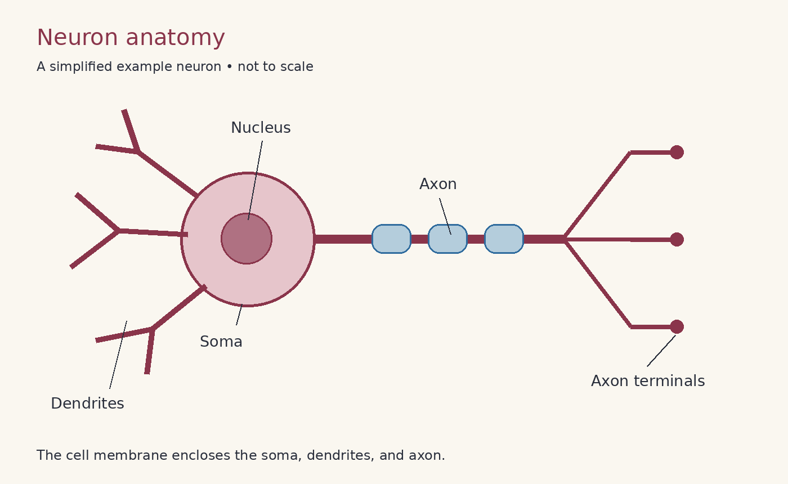

*Simplified neuron anatomy; not to scale.*

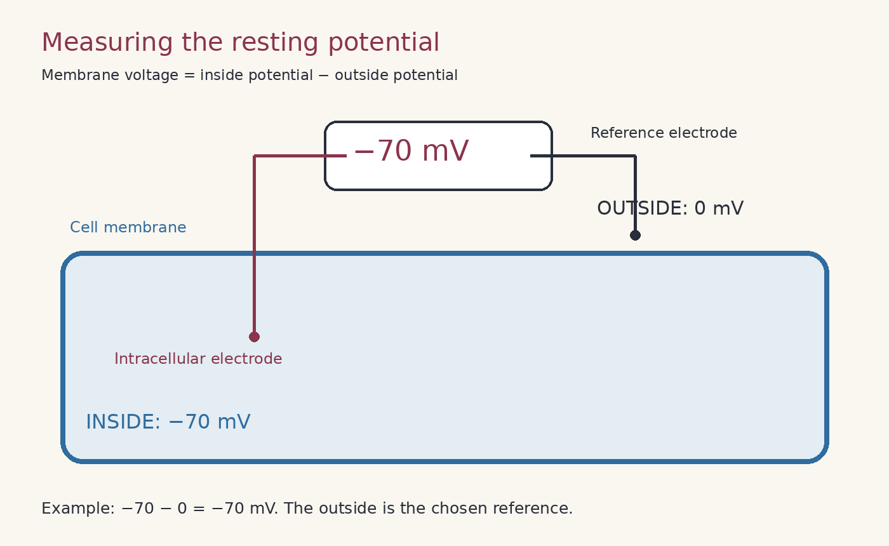

*The outside reference is assigned 0 mV; it does not mean the outside solution contains no ions or charges.*

**Membrane vs. resting potential — remember:** every resting potential is a membrane potential, but a membrane potential measured during a signal is not a resting potential.

**Further reading:** [Electrical signals of nerve cells](https://www.ncbi.nlm.nih.gov/books/NBK11053/) and [the ionic basis of the resting membrane potential](https://www.ncbi.nlm.nih.gov/books/NBK10931/).

##### Diffusion and Electrostatics [Difusão e Eletrostática]

Both inside and outside of the neuron, ions and other particles exist in an aqueous solution and are able to move around. 

There are many forces that can guide their behavior, two of which are important to us: the diffusive and electrostatic forces.

It’s important for us to understand how these forces affect the movement of charged particles such as K+ and Na+ ions, since the movement of these ions across the membrane of a neuron can change its membrane potential.

Both of these forces will be important for us when understanding how the resting potential is established. By the end of this video, you should be able to answer the following questions:
1. What are diffusive and electrostatic forces?
2. How can these forces affect the movement of an ion across a neuron’s membrane?

---

- **Notes in Portuguese**

A **difusão** é o processo pelo qual as partículas se espalham ou misturam, por exemplo, numa solução. 
Por exemplo, quando jogamos um corante no copo d'agua. Gradualmente o corante vai se espalhando pelo líquido até que esteja uniformemente distribuído > Essa disseminação gradual é a difusão.

O movimento do corante é governado pelo movimento térmico de moléculas de corante individuais. Elas estão basicamente balançando em escala atômica e esbarrando uns nos outros.

No conjunto, o processo de difusão faz com que as partículas se movam de regiões de alta concentração para regiões onde a concentração é menor. Mesmo sendo um processo puramente aleatório, para todos os efeitos, podemos pensar na difusão como uma força inevitável que empurra as partículas para baixo. 

A segunda chave para compreender o potencial de repouso é a **força eletrostática**. Já mencionamos anteriormente quando falamos sobre baterias.
As partículas podem ter uma carga associafa a elas, positivo ou negativo. Essas cobranças servem de base para toda a eletricidade. 

Cargas diferentes se atraem, cargas semelhantes se repelem.

---

- **Question 1**
K+ (potassium) ions are at a high concentration (about 150 mM) inside the neuron, and at a low concentration (about 10 mM) outside. Via diffusion, I would expect: **K+ ions to move from the inside to the outside of neuron** (Na difusão, a alta concentração se espelha para uma concentração menor)

- **Question 2**
At rest, the inside of a neuron is said to be more negative relative to the outside of the neuron (resting potential of about -75 mV). Given a K+ ion (potassium) and based purely on electrostatic forces, I would expect: **K+ ions to move from the outside to the inside of the neuro** (Na força eletrostática, cargas diferentes se atraem e cargas semelhantes se repelem)

---

**Summary in English**

- **Diffusion** results from random thermal motion. Its net effect is movement from higher to lower concentration when a pathway is available.
- **Electrostatic forces** attract opposite charges and repel like charges.
- For K⁺, a higher concentration inside favors outward diffusion. A negative interior electrically attracts K⁺ inward.
- These two influences can oppose one another. Together they form the ion's **electrochemical driving force**.
- Ions need a permeable pathway, such as an open channel, to cross the lipid membrane.
- At equal concentrations, particles keep moving randomly even though diffusion produces no net movement in either direction.

**Example from the notes:** with 150 mM K⁺ inside and 10 mM outside, diffusion favors K⁺ leaving the cell. Considering the electrical effect alone, a negative interior favors K⁺ entering.

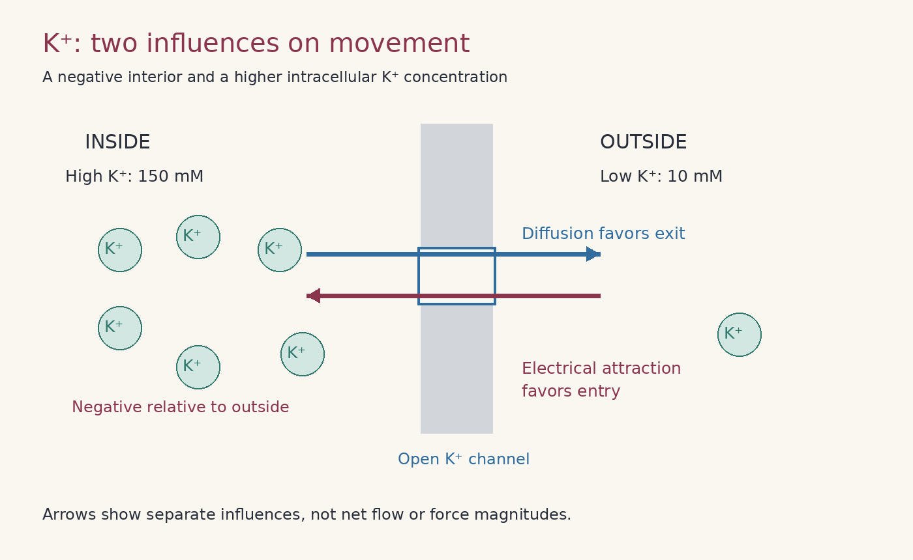

*The arrows show separate influences on K⁺, not the final net flow. They are schematic and do not represent measured force magnitudes.*

**Further reading:** [How ionic movements produce electrical signals](https://www.ncbi.nlm.nih.gov/books/NBK11054/).

##### Potentials and Equilibrium

**Summary in English — introductory preview**

*No lesson notes have been added under this heading yet. This is a short conceptual preview, not a summary of a completed video.*

An ion reaches **electrochemical equilibrium** when its concentration gradient and electrical influence balance. Its **equilibrium potential** is the membrane voltage at which it has no net passive movement through available channels.

For a membrane permeable only to K⁺, outward diffusion can leave a small excess of negative charge inside. This increasingly attracts K⁺ inward until the two influences balance.

**Remember:** no net movement does not mean no movement. At equilibrium, ions can still cross in both directions at equal average rates.

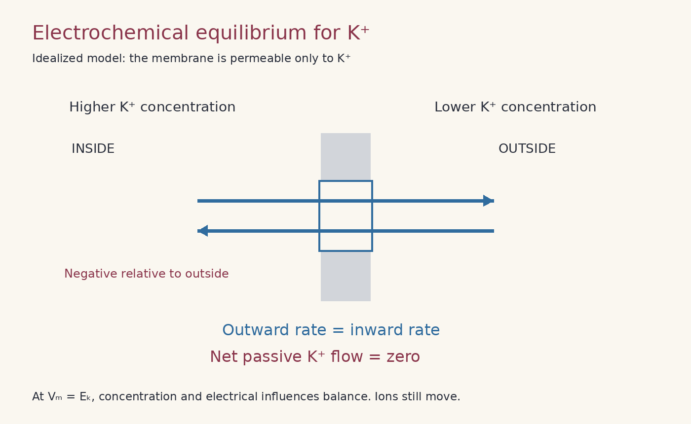

*Idealized K⁺-only model. A living resting neuron is a maintained steady state involving several ions and energy-consuming pumps; its resting potential is not necessarily equal to any single ion's equilibrium potential.*

**Further reading:** [The forces that create membrane potentials](https://www.ncbi.nlm.nih.gov/books/NBK11102/).

---

**Introduction**
Ion movement through membrane channels is guided by diffusive and electrostatic forces, and the movement of these ions can change the membrane potential. Here we will consider the movement of a single ion: K+. We will investigate how an equilibrium can be reached when one ion is allowed to flow across the membrane. By the end of this activity, you should understand:

How would the membrane potential change if K+ ions are allowed to flow out of the cell, or into the cell?
How are diffusive and electrostatic forces related to each other?
When is equilibrium reached for the flow of charged ions?

---

- **Notas do vídeo em Português**
Vamos pensar no esquema básico de membrana, temos a parte intracelular e extracelular.

Nosso voltímetro possui um eletrodo terra fora da célula, e a outra ponta está na parte intracelular do neurônio, medindo a diferença de voltagem entre esses dois pontos. 

Suponha que coloquemos um excesso de íons negativos no interior da célula, de modo que haja uma diferença de potencial de 60mV através da membrana. Então, como estamos referenciando nossa medição ao ponto fora da célula, diríamos que há um potencial de membrana de -60mV.

Em repouso, a maioria das células do corpo humana na verdade possui um potencial de membrana negativa, variando de -5 a -100mV. Em neurônios, esse potencial de repouso é geralmente de -40 a -90 mV.

Cada lado da membrana é basicamente **eletroneutro**. Isso significa que, em cada lado, basicamente não há carga líquida. Isso ocorre porque, na solução em massa, para cada carga positiva, existe uma carga negativa para equilibrá-la.

Sempre terá a mistura ambiente de cargas positivas e negativas.

No entanto, o potencial de membrana vem de um pequno desequilíbrio que se acumula muito próximo à membrana. Esse desequilíbrio de cargas gera um campo elétrico através da membrana que resulta em um **potencial elétrico**. (No mundinho de física e eletrônica, essa configuração é basicamente um capacitor.)

A membrana da imagem é uma **bicamada lipídica** sem aberturas, portaanto, os íons não podem atravessá-la.

Se tivermos uma concentração igual de potássio em ambos os lados da membrana. O que veremos em nosso voltímetro?
---

- **Question 1**
If we measure Em right now, it will be: **0mV**

Now let's think about what happens when we have an imbalance of ion concentrations. We'll focus on one particular ion - **potassium**. Let’s introduce a concentration imbalance and increase the number of potassium ions inside the cell relative to the number outside the cell, just like in an actual neuron, as shown in the figure below. 

We will keep the intracellular and extracellular fluids electroneutral by making sure that there's an appropriate number of matching negative ions on both sides of the membrane. 

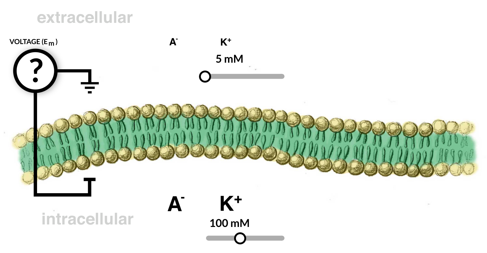

We still have an impermeable membrane - the only thing that we've changed was to alter the relative potassium concentrations.

- **Question 2**
The concentration of potassium ions is 5 mM outside and 100 mM inside, but the membrane is impermeable to these ions. We will keep the intracellular and extracellular fluids electroneutral by making sure that there's an appropriate number of matching negative ions (depicted as ‘A-’ above) on both sides of the membrane.

If we measure Em in this new situation, it will be: **0Mv - Again, both sides of the membrane are electroneutral, and, more importantly, the membrane is currently impermeable to K+ ions. So, the membrane potential is still 0 mV.**

What happens if we add a channel to the membrane? Specifically, let’s add a potassium channel (purple), as shown in the figure below.

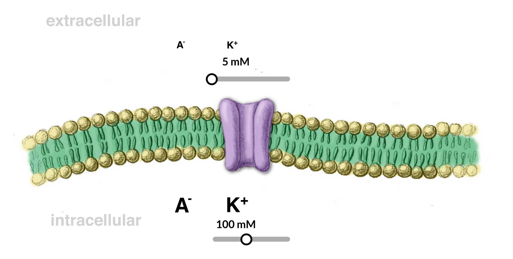

Channels are passages through which ions can travel. Think about what happens to the potassium ions now that we've added a potassium channel. 

- **Question 3**
If we have 100 millimolar potassium inside of the cell and 5 millimolar potassium outside, which direction do you think potassium ions will flow after we add the potassium channel? **It will move out of the cell.** *[Por que o interior está com a carga mais pesada?]*

- **Question 4**
By now, you may have already predicted that this migration of positively charged ions would create an electric field. Let's see how well you understand this idea.

As K+ ions move across the membrane out of the cell, what will the membrane potential become? **A negative voltage** *[Isso acontece porque a carga interior é negativa?]*

---

- **Notas do vídeo (02) em português**
Anteriormente, éramos eletro neutros para começar com o íon negativo para corresponder a todos os íons positivos em ambos os lados da membrana.

Quando você remove íons positivos de dentro, vocês fica com um excesso de negativos. Enquanto isso, a solução eletroneutra do lado de fora ganhou cargas positivas do potássio (então teremos um excesso de carga positiva). > Ou seja, o interior será mais negativo em relação ao exterior. Como a convenção é definir a voltagem extracelular como nosso valor zero (ponto de referência), o potencial de membrana seria negativo.

---

- **Question 5**
Given what you know so far, what do you predict will happen to the intracellular and extracellular K+ concentrations at equilibrium? **[K+]in is greater than [K+]out (most of the K+ ions stay inside the cell)**

---

- **Notas do vídeo (03) em português**

Uma pequena quantidade se difunde, mas a concentração é ainda maior por dentro. Isso acontece porque estamos lidando com íons carregados. Se tivéssemos apenas partículas sem carga fluino, eles se difundiriam na mesma concentração em ambos os lados da membrana.

A razão pela qual isso não acontece com o potássio é que temos uma força adicional em que pensar: **a força eletrostática**. À medida que começamos a mover mais potássio ao longo do gradiente de concentração de dentro para fora, aquela carga positiva líquida adicional cria uma força eletrostática que repele cargas positivas adicionais de se difundir *(diferentes se atraem, iguais se repelem)*.

Vamos pensar sobre o que realmente leva para criar um potencial de membrana de 80mV negativos, o que é o potencial de equilíbrio do potássio. 

---

- **How many move?**

How many K+ ions need to move in order to reach an equilibrium? **1 in 100 (??)**

---

- **Notas do vídeo (04) em português**

Movendo apenas um em cada 100.000 íons através da membrana é suficiente para criar um potencial de membrana negativo de 80mV. 

Em células e neurônios reais, existem trilhões de íons dentro da célula. Então, mesmo movendo uma em cada 100.000 íons ainda significa que estamos movendo milhões de íons para fora para criar esse equilíbrio.

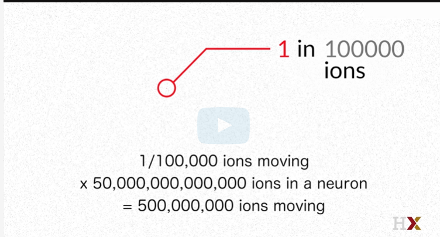

A principal coisa a entender é que a forçaa eletrostática para mover apenas uma pequena fração de partículas carregadas para o outro lado da membrana é suficiente para equilibrar a difusão de um grande número de partículas. > Isso dá uma noção de quão mais forte é a força eletrostática em comparação com a difusão.

Além disso, isso significa que mesmo que os íons se movam através da membrana para gerar potenciais de membrana, tão poucos íons precisam se mover para que as concentrações dentro e fora sejam efetivamente inalterado.

Apenas uma pequena proporção de íons se move em relação ao número total de íons. Podemos, portanto, basicamente *ignorar* os íons que se movem através da membrana quando falamos sobre concentrações intracelulares e extracelulares.

---

- **Question 6**
What would happen to the K+ ions when more negative ions are added extracellularly? **More K+ flows out**

- **Question 7**
Consider a neuron in which the Cl- concentration inside of the cell is 15 mM and outside of the cell is 140 mM.

Once the ions flow and reach an equilibrium, approximately what will be the concentration of Cl- inside of the cell? **15mM - Only a tiny fraction of Cl⁻ ions needs to enter the neuron to create an electrical force that balances the concentration gradient. At *electrochemical equilibrium*, the concentrations remain nearly unchanged—they do not become equal inside and outside.**

---

Can you see now how this concentration gradient is kind of like a little engine that drives the electrical potential? 

Exactly how many ions are on both sides doesn't quite matter, it's the relative concentration gradient that determines the equilibrium potential. You can check your understanding of this idea using the questions that follow.

We can formalize this relationship with something called the **Nernst equation**. We'll return to the Nernst equation in greater detail soon. 

In short, it allows us to calculate the potential across a membrane given the concentrations of a particular ion inside and outside the cell.

In the previous example, when we had a membrane that was only permeable to potassium, the equilibrium membrane potential of the cell can be calculated based on the concentration of potassium inside and outside the cell. However, neurons have many ions that contribute to the resting potential so we can't determine the membrane potential of an actual cell just by looking at potassium.

---

##### The Nernst Potential

- **Introduction**
Now that you have an understanding of what forces affect ion flow and how the flow of ions can lead to changes in the membrane potential, we can utilize a formal equation. 

This equation is the **Nernst Potential**, which calculates the membrane potential at which the diffusion and electrostatic forces for an ion balance out, given particular concentrations inside and outside of the cell. This equation is very powerful in helping us to summarize the behavior of an ion given certain conditions. By the end of this lesson, you should be able to answer the following questions:

1. How do temperature and valence affect the Nernst Potential?

2. Do the absolute or the relative concentrations of ions matter in determining the Nernst Potential? How do changes to the intracellular and extracellular concentrations of K+ affect its Nernst Potential?

3. What is "driving force," and how do we calculate it?

You may find it helpful to refer to the course [formula sheet](https://courses.edx.org/assets/courseware/v1/71475402bce93432b9b909b9180885c1/asset-v1:HarvardX+MCB80.1x+2T2023+type@asset+block/Ref_Sheet_ln_def.pdf) to solve some of the problems on this and the following pages.

---

- **Notas do vídeo em  português**
Revisão de tudo que vimos:

    - Sabemos que temos alguns íons muito importantes dentro e fora da célula. Uma membrana de bicamada lipídica e alguns canais de vazamento seletivos de íons.

    - Sabemos que quando medimos o potencial de repouso num neurônio, estamos medindo em gradiente elétrico, ou a diferença em energia potencial entre o interior e o exterior da célula.

    - Sabemos que um gradiente elétrico se força através da membrana devido ao vazemento de íons diminuindo seu gradiente de concentração.

    - Sabemos que o fluido dentro e fora da célula é basicamente eletro neutro, e que apenas um número muito pequeno de íons, como potássio se movendo através da membrana, pode causar grandes mudanças no potencial através da membrana.

    - E o mais importante, sabemos que um equilíbrio é alcançado quando o gradiente de concentração e gradiente elétrico são iguais e opostos.

Podemos calcular qual seria o potencial elétrico usando a **equação de Nernst**. Este potencial de equilíbrio nos diz em que membrana forças elétricas potenciais e difuão exatamente equilibrar um ao outro.

Vejamos os diferentes componentes da equção de Nernst:

[Nernst_Potential_01](images/Nernst_Potential_01.png)

- A variável **E**, no lado esquerdo da equação, é a variável dependente que estamos resolvendo. Essa variável pode ter outros nomes, que vamos ver ao longo do curso. Existem três termos que podem se referir à veriável **E**: Potencial de Nernst, potencial de reversão e potencial de equilíbrio.
Quando resolvemos a equação de Nernst para um determinado íon e sua concentração dentro e fora da célula, estamos resolvendo para o ponto em que a força eletrostática se equilibra examente a **força difusional**. 
Ao resolver a equação de Nernst, chegamos a este ponto de equilíbrio, que é chamado de **potencial de Nernst**. Ele é alcançado quando o sistema está em equilíbrio. Então as vezes você ouvirá isso ser chamado de **potencial de equilíbrio**.
O **potencial de reversão** é o ponto em que o fluxo líquido de íons muda de direção. Geralmente nos referimos a potenciais de reversão quando falamos sobre canais iônicos.

> Pra não confundir: 
> Potencial de membrana é o potencial elétrico medido através da membrana.
> Potencial de repouso é apenas o potencial da membrana medido para célular que está em repouso. Para um neurônio, o potencial de repouso está próximo do potencial de Nernst de potássio.
> O potencial de repouso é composto pelo fluxo de múltiplos íons, bem como o trabalho das bombas de íons ativos.
> Enquanto, o potencial de Nernst é apenas o equilíbrio passivo para um único íon. 

Voltando para a equação...

O potencial de Nernst é igual ao gás universal, constante (**R**) vezes a temperatura absoluta medida em graus Kelvin (**T**), dividida pela valência do íon (**z**) vezes a constante de Faraday (**F**), tudo multiplicado pelo logaritmo natural (**ln**) da concentração do íon fora da célula ou a concentração do íon dentro da célula.

---

- **Question 1**
What will happen to Eion if we move from 37˚C to 4˚C? **Eion will decrease by 10%.**

[Nernst_Potential_02](images/Nernst_Potential_02.png)

--

(PAREI NO SEGUNDO VIDEO)