# Fundamentos de Neurociência, Parte 1: As propriedades elétricas do neurônio

> Versão em português brasileiro de [Fundamentals of Neuroscience, Part 1.md](Fundamentals%20of%20Neuroscience,%20Part%201.md). Tradução dos textos de aula, revisão das notas de vídeo e tradução dos resumos e exercícios presentes no arquivo-fonte.
>
> **Como ler:** os trechos marcados como **Ajuste conceitual** ou **Correção de cálculo** corrigem imprecisões; os marcados como **Complemento didático** acrescentam explicações. As imagens existentes foram mantidas por referência e podem conter texto em inglês. Não foram atribuídas datas de estudo.
>
> **Limite atual:** conteúdo até “Resolução de problemas com o potencial de Nernst”, inclusive. “A equação de GHK” permanece como próximo tópico, ainda não estudado.

<!-- translation-source: Fundamentals of Neuroscience, Part 1.md; source-blob-sha: 26e122474debbdce39a71eb19397b756d7924d59 -->

## Introdução ao MCB80.1x

Neste curso, estudaremos as propriedades elétricas de neurônios individuais, construindo uma base para compreender o funcionamento fundamental do sistema nervoso.

**Resumo**

O curso explora como neurônios individuais geram sinais elétricos. Compreender a membrana de um único neurônio e os movimentos de íons ajuda a compreender a comunicação em todo o sistema nervoso.

**Em palavras simples:** antes de estudar o cérebro como uma rede, estudamos como uma célula nervosa produz sinais elétricos.

## Aula 1: O potencial de repouso

**Resumo**

O potencial de repouso é a diferença de potencial elétrico através da membrana de um neurônio quando ele está em repouso. A aula conecta eletricidade básica, movimento de íons e propriedades da membrana para explicar como essa tensão surge.

**Pergunta central:** como uma célula mantém uma diferença de tensão entre seu interior e seu exterior?

### Introdução à Aula 1: O potencial de repouso

Começamos o estudo do sistema nervoso com um único neurônio. Como veremos, a eletricidade tem um papel fundamental na comunicação entre neurônios. Por isso, compreender suas propriedades elétricas é essencial para compreender o sistema nervoso.

Nesta aula, observamos um neurônio “em repouso”: uma célula que, no modelo introdutório, não participa de sinalização elétrica ativa naquele momento. Mesmo assim, ela apresenta uma diferença de tensão através da membrana, chamada **potencial de repouso**.

É por meio de mudanças em relação a esse potencial que ocorre a sinalização elétrica. Precisamos, portanto, entender o que ele é, como se estabelece e como calculá-lo.

**Resumo**

O neurônio em repouso continua tendo uma tensão de membrana. Como os sinais elétricos envolvem mudanças nessa tensão, o potencial de repouso é nosso ponto de partida. “Em repouso” não significa que os íons param de se mover ou que a célula deixa de consumir energia.

#### Destaques da Aula 1

**Resumo**

A sequência de ideias é: bioeletricidade → tensão elétrica → potencial de membrana → difusão e forças eletrostáticas → equilíbrio eletroquímico. Esses conceitos explicam como o movimento de íons pode produzir uma tensão estável através de uma membrana.

##### A história da bioeletricidade

No cotidiano, interagimos com a eletricidade de várias formas. Raios em tempestades e a aderência de roupas causada por eletricidade estática são exemplos de fenômenos associados à separação de cargas. Dispositivos eletrônicos também utilizam correntes elétricas. Assim como os sistemas não vivos, os seres vivos obedecem às leis físicas da eletricidade.

Uma característica importante do sistema nervoso é o uso de sinais elétricos na comunicação entre células. Antes de estudar neurônios e cérebro em profundidade, precisamos compreender um pouco de eletricidade e sua relação com os neurônios.

**Notas do vídeo — revisadas**

Para entender a bioeletricidade, voltamos à Bolonha do século XVIII, onde vivia Luigi Galvani, médico e pesquisador italiano.

Galvani observou que a estimulação elétrica de nervos de rãs podia provocar contrações musculares. Suas observações incluíram preparações em que instrumentos metálicos e eletricidade estática desencadeavam movimentos nas pernas. Ele interpretou esses fenômenos em termos de “eletricidade animal”.

Alessandro Volta, físico contemporâneo de Galvani, repetiu experimentos e questionou essa interpretação. Seus estudos levaram à pilha voltaica, desenvolvida no fim do século XVIII e apresentada em 1800: era possível produzir eletricidade por meios não biológicos.

A divergência entre os dois ajudou a estabelecer o estudo da bioeletricidade, isto é, dos fenômenos elétricos em organismos vivos. O termo **galvanismo** ficou associado a esses fenômenos.

**Ajuste histórico relevante:** a anotação original situava o episódio da rã em 1771. Evitamos tratar essa data como estabelecida para o célebre experimento: os experimentos famosos são normalmente associados à década de 1780, e Galvani publicou sua obra principal sobre eletricidade animal em 1791. A **pilha voltaica foi inventada por Volta**, não por Galvani. A expressão “pilha voltaica de Galvani” confunde os dois pesquisadores.

**Resumo**

- Galvani relacionou estimulação elétrica à contração muscular em rãs.
- Volta questionou a explicação e desenvolveu a pilha voltaica, apresentada em 1800.
- A controvérsia contribuiu para a história da bioeletricidade.
- Hoje explicamos os sinais elétricos dos neurônios pelo movimento de íons através das membranas.

**Leitura adicional do arquivo-fonte:** [Publicação original de Galvani, de 1791 — Smithsonian Libraries](https://library.si.edu/digital-library/book/aloysiigalvanid00galv).

##### Tensão elétrica

Para compreender as propriedades elétricas do neurônio, precisamos conhecer os conceitos, componentes e termos básicos da eletricidade. Ao final desta parte, devemos responder:

1. Como cargas de mesmo sinal e de sinais opostos interagem?
2. O que é tensão elétrica? Como ela se relaciona com o potencial elétrico?

Antes de aprofundar o potencial de repouso, faremos um breve desvio pela física. Vamos definir a tensão elétrica com mais precisão.

Enquanto a **corrente** informa a taxa de fluxo de carga, a **tensão elétrica** ajuda a descrever a diferença elétrica que pode impulsionar esse fluxo.

**Tensão elétrica é a diferença de potencial elétrico entre dois pontos.**

Podemos comparar o potencial elétrico a outros conceitos de energia potencial. Uma bola no alto de uma colina possui energia potencial gravitacional: ao rolar para baixo, essa energia pode se transformar em movimento. A interação gravitacional entre a bola e a Terra ajuda a explicar por que a bola desce em vez de subir espontaneamente.

De modo semelhante, o potencial elétrico permite descrever a energia associada à posição de uma carga em um campo elétrico.

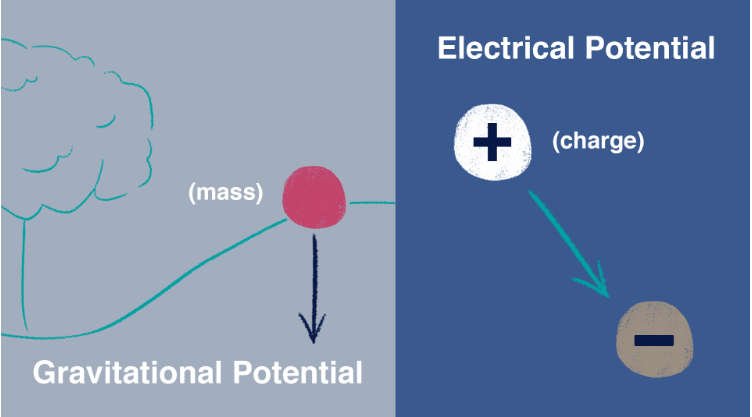

Para entender essa ideia, precisamos definir a **força eletrostática**: a atração ou repulsão entre partículas eletricamente carregadas. Íons podem ter carga positiva (+) ou negativa (−).

As regras são:

- Cargas de sinais opostos se atraem.
- Cargas de mesmo sinal se repelem.

> **Tradução mental:** + e − se atraem; + e +, ou − e −, se repelem.

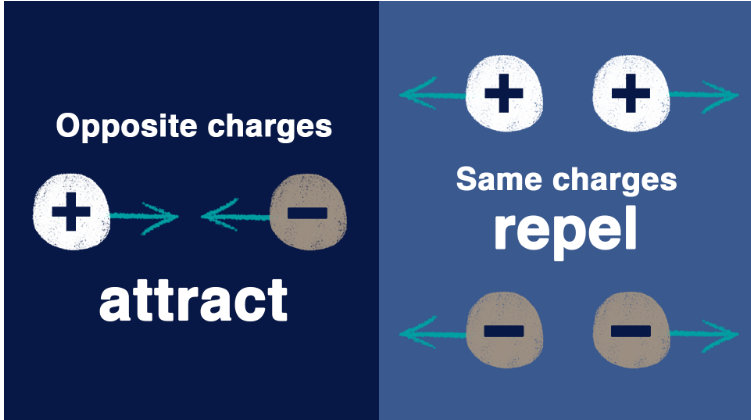

Agora podemos pensar em dois pontos, A e B. Se A estiver em um potencial elétrico maior que B, o efeito do campo elétrico sobre uma carga positiva favorece seu deslocamento em direção a B; para uma carga negativa, favorece o deslocamento em direção a A.

A tensão expressa essa diferença de potencial e é medida em **volts (V)**.

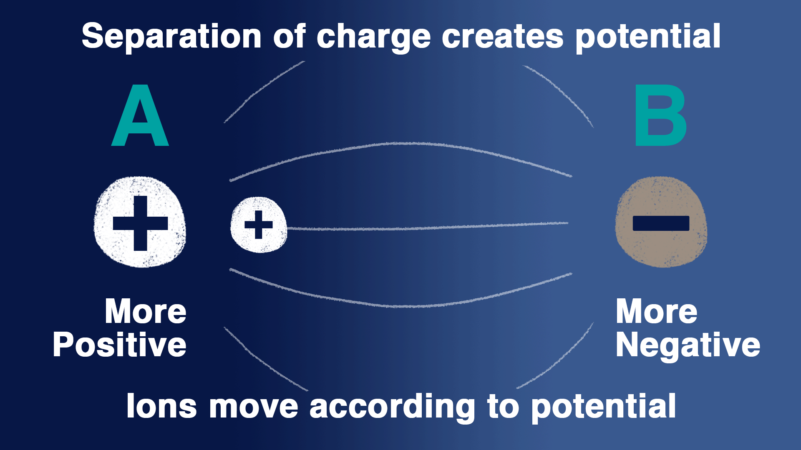

**Ajuste conceitual:** potencial elétrico não é simplesmente “quantidade de carga”. É energia potencial elétrica por unidade de carga. A força depende do campo elétrico e do sinal da carga; a tensão é a diferença de potencial entre pontos.

Na neurociência, os pontos de interesse ficam dentro e fora da célula. Eles são separados pela membrana, cuja bicamada lipídica restringe fortemente a passagem de íons. Para atravessá-la, os íons precisam de proteínas de transporte, como canais ou bombas.

Íons que atravessam canais podem gerar uma pequena separação de cargas entre os dois lados, produzindo uma tensão através da membrana. A baixa permeabilidade da bicamada aos íons ajuda a manter essa separação, de forma semelhante ao armazenamento de carga em um capacitor.

A tensão é uma medida relativa. Na convenção usada aqui, o exterior da célula é o ponto de referência, definido como 0 mV:

$$V_m = V_{\text{dentro}} - V_{\text{fora}}$$

Se o interior estiver 50 mV abaixo do exterior, o potencial de membrana será **−50 mV**.

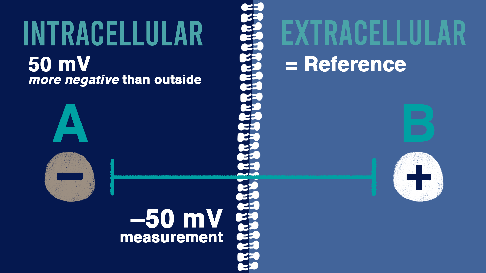

**Questão 1**

Como se chama a diferença de potencial elétrico entre dois pontos? **Tensão elétrica.**

Em que unidade ela é medida? **Volts.**

**Questão 2**

Na neurociência, a tensão através da membrana é medida em relação a quê? **Ao exterior da célula.**

**Resumo**

- **Força eletrostática:** cargas opostas se atraem; cargas iguais se repelem.
- **Potencial elétrico:** energia potencial elétrica por unidade de carga em um ponto.
- **Tensão:** diferença de potencial elétrico entre dois pontos, em volts.
- **1 mV = 0,001 V.**
- **Corrente:** taxa de passagem de carga elétrica. Pode haver tensão sem corrente.
- A bicamada restringe a passagem de íons; canais oferecem vias seletivas, enquanto bombas usam energia para transportá-los.
- A convenção é **Vₘ = Vdentro − Vfora**.
- Se o interior estiver 50 mV abaixo da referência externa, **Vₘ = −50 mV**.

**Em palavras simples:** tensão descreve uma diferença elétrica; corrente descreve carga em movimento. O fluxo de um íon depende tanto do efeito elétrico quanto de seu gradiente de concentração.

**Exemplo:** uma medida de −60 mV no interior, em relação a uma referência externa de 0 mV, corresponde a um potencial de membrana de −60 mV.

##### Apresentando o potencial de repouso

Neurônios enviam sinais utilizando eletricidade. A membrana lipídica separa soluções com partículas carregadas, como os íons potássio (K⁺) e sódio (Na⁺). A distribuição dessas partículas e a permeabilidade da membrana permitem uma diferença de potencial elétrico entre os lados.

Em um neurônio em repouso, essa diferença recebe o nome de **potencial de repouso**. Ao estudar esta parte, pergunte-se:

1. Quais são as principais partes de um neurônio?
2. O que é potencial de membrana e como medi-lo?
3. Quais íons mais influenciam o potencial de membrana?

**Notas do vídeo — revisadas**

Um neurônio típico tem um **corpo celular**, ou **soma**, que contém o núcleo e outras estruturas celulares. Do soma partem prolongamentos, como **dendritos** e **axônio**. A membrana celular envolve essas estruturas e é formada por uma bicamada de moléculas lipídicas, que separa o interior do exterior.

Vamos observar um pequeno trecho da membrana do soma. Mesmo em repouso, há uma diferença de potencial elétrico entre o interior e o exterior de um neurônio vivo. Essa pequena, mas importante, tensão é o **potencial de membrana**.

**Ajuste conceitual:** a frase original “a célula não é eletricamente neutra” precisa de cuidado. O líquido de cada compartimento permanece aproximadamente eletroneutro. Uma minúscula separação de cargas próxima à membrana é suficiente para gerar a tensão; não é necessário um grande excesso de carga em todo o interior.

Uma bateria fornece uma analogia: ela mantém uma diferença de potencial entre os terminais. Em um circuito externo adequado, essa diferença pode impulsionar o movimento de elétrons e permitir, por exemplo, acender uma lâmpada.

**Complemento didático:** em um fio metálico, elétrons se deslocam do terminal negativo para o positivo; a corrente convencional tem o sentido oposto. Em soluções biológicas, a corrente é transportada por íons.

Se medirmos um neurônio em repouso, podemos encontrar um valor como **−70 mV**. Precisamos sempre indicar a referência: neurofisiologistas usam o exterior da célula como “terra”, ou referência elétrica. Portanto, a tensão interna é medida em relação à referência extracelular.

Para comparar, uma pilha AA tem cerca de 1,5 V. A magnitude de 70 mV é aproximadamente 21 vezes menor. Embora pequena, essa tensão tem efeitos biológicos importantes.

A membrana não é uma pilha química convencional: o potencial neuronal depende de gradientes iônicos e da permeabilidade seletiva. Bombas e outros transportadores mantêm os gradientes usando energia direta ou indiretamente.

Os líquidos dentro e fora da célula são soluções aquosas com proteínas, açúcares e íons. Entre as espécies carregadas estão magnésio, bicarbonato, fosfato, sulfato e muitas proteínas. Para começar, vamos nos concentrar em **Na⁺, K⁺, Ca²⁺ e Cl⁻**.

**Ajuste conceitual:** o cálcio livre intracelular não está presente em concentração alta: ela é muito baixa. Sua importância para sinalização não exige abundância no citoplasma. Colágeno, citado nas notas como exemplo de proteína, é principalmente uma proteína da matriz extracelular, não um exemplo típico de proteína do citoplasma neuronal.

**Diferença entre “potencial de membrana” e “potencial de repouso”**

1. **Potencial de membrana:** termo geral para a tensão através da membrana em qualquer instante. Pode variar bastante durante a atividade, por exemplo de −90 mV a +60 mV em exemplos didáticos.
2. **Potencial de repouso:** o valor de referência da membrana quando o neurônio está em repouso, frequentemente apresentado como algo entre −60 e −70 mV.

**Precisão:** esses números não são limites universais. Os valores dependem do tipo celular e das condições.

**Questão 1**

Um pesquisador mede um neurônio recém-descoberto. O exterior está 60 mV mais positivo que o interior. Qual é o potencial de membrana, em mV? **−60.**

**Questão 2**

Quais íons destacados no vídeo são importantes para compreender o potencial de repouso? **Cl⁻, Na⁺, K⁺ e Ca²⁺.**

**Precisão:** eles não contribuem igualmente em todos os neurônios; a permeabilidade ao K⁺ costuma ter papel especialmente importante em repouso.

**Resumo**

- Um neurônio típico tem dendritos, soma com núcleo e axônio.
- O potencial de membrana é a tensão em qualquer instante; o potencial de repouso é seu valor basal em repouso.
- **−70 mV** é um exemplo: o interior está 70 mV abaixo do exterior.
- Concentrações iônicas e permeabilidades determinam como os íons afetam a tensão.
- Bombas mantêm os gradientes que tornam a sinalização possível.
- A membrana se comporta parcialmente como um capacitor, separando pequenas quantidades de cargas opostas.

**Em palavras simples:** a membrana separa duas soluções salinas. Diferenças de concentração e vias seletivas para os íons permitem o surgimento de uma tensão.

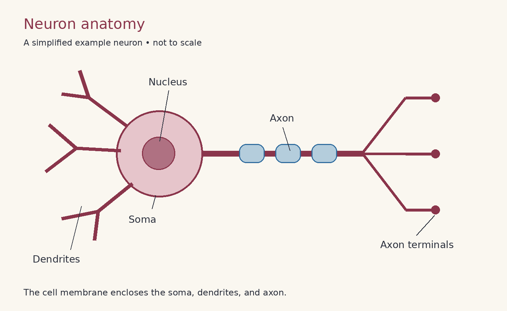

*Anatomia simplificada; sem escala.*

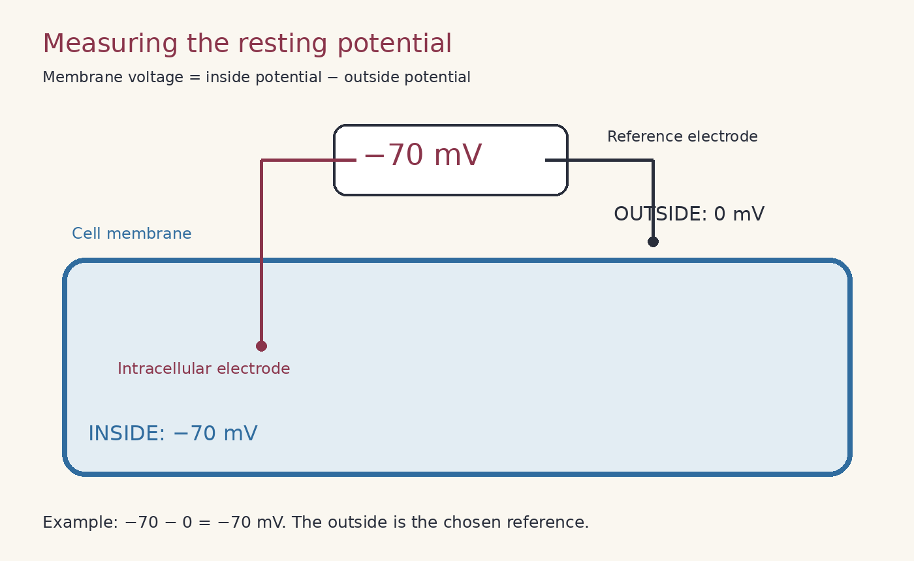

*Definir o exterior como 0 mV não significa que a solução externa não tenha cargas ou íons.*

**Para lembrar:** todo potencial de repouso é um potencial de membrana, mas um potencial de membrana medido durante um sinal não é o potencial de repouso.

**Leituras adicionais do arquivo-fonte:** [Sinais elétricos das células nervosas](https://www.ncbi.nlm.nih.gov/books/NBK11053/) e [Base iônica do potencial de repouso](https://www.ncbi.nlm.nih.gov/books/NBK10931/).

##### Difusão e eletrostática

Dentro e fora do neurônio, íons e outras partículas estão em solução aquosa e podem se mover. Entre as influências sobre seu comportamento, duas são centrais: a difusão e a força eletrostática.

Precisamos compreender como elas afetam partículas carregadas, como K⁺ e Na⁺, porque seu movimento através da membrana pode mudar o potencial de membrana. Ambas ajudam a explicar o potencial de repouso.

Ao final, devemos responder:

1. O que são difusão e forças eletrostáticas?
2. Como elas afetam a passagem de um íon através da membrana?

**Notas do vídeo — revisadas**

A **difusão** é o processo pelo qual partículas se espalham e se misturam. Um exemplo é uma gota de corante em um copo de água: aos poucos, suas moléculas se distribuem pelo líquido.

Isso resulta do movimento térmico aleatório das moléculas, que se movimentam e colidem. Considerando muitas partículas, há um fluxo líquido de regiões mais concentradas para regiões menos concentradas, quando há uma via disponível.

**Ajuste conceitual:** “descer o gradiente” não significa descer fisicamente por gravidade. Significa ir da maior para a menor concentração. A difusão pode ser descrita como uma tendência efetiva associada ao gradiente, embora cada partícula se mova aleatoriamente.

A outra influência é a **força eletrostática**. Partículas podem carregar cargas positivas ou negativas. Cargas opostas se atraem e cargas iguais se repelem.

**Questão 1**

Há cerca de 150 mM de K⁺ dentro do neurônio e 10 mM fora. Considerando apenas a difusão, qual é a tendência? **Movimento líquido de K⁺ do interior para o exterior**, se a membrana for permeável a ele.

**Questão 2**

O interior em repouso está negativo em relação ao exterior, por exemplo a −75 mV. Considerando apenas o efeito elétrico sobre K⁺, qual é a tendência? **Movimento do exterior para o interior**, pois a carga positiva é atraída pelo interior negativo.

**Resumo**

- A difusão resulta do movimento térmico aleatório; seu efeito líquido favorece o deslocamento da maior para a menor concentração.
- Cargas opostas se atraem; iguais se repelem.
- Para K⁺ mais concentrado dentro, a difusão favorece a saída; o interior negativo favorece eletricamente a entrada.
- Essas influências podem se opor e, juntas, determinam a tendência eletroquímica.
- Íons precisam de uma via permeável, como um canal aberto, para atravessar a bicamada.
- Mesmo com concentrações iguais, partículas continuam se movendo aleatoriamente; o fluxo líquido pode ser zero.

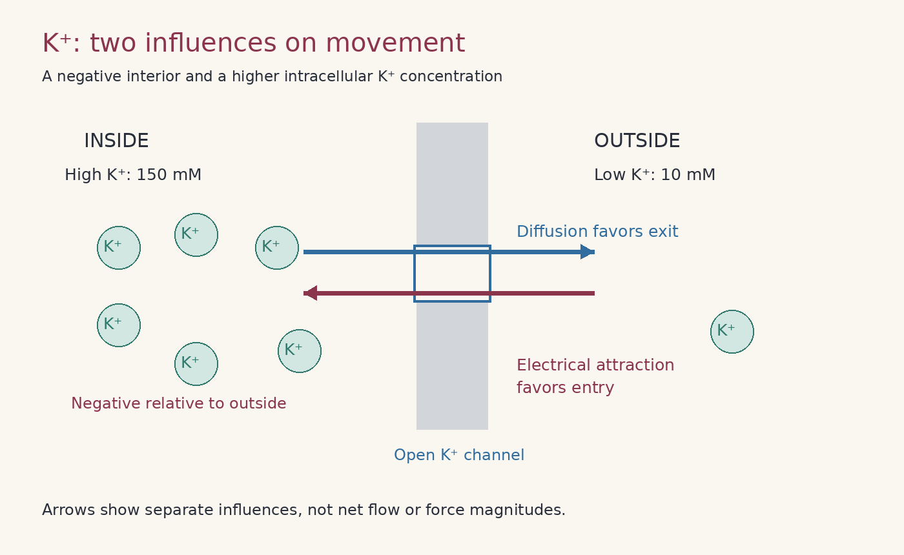

*As setas representam influências separadas, não o fluxo líquido final nem magnitudes de forças medidas.*

**Leitura adicional do arquivo-fonte:** [Como o movimento iônico produz sinais elétricos](https://www.ncbi.nlm.nih.gov/books/NBK11054/).

##### Potenciais e equilíbrio

**Resumo conceitual presente no arquivo-fonte**

Um íon atinge **equilíbrio eletroquímico** quando os efeitos químico e elétrico se equilibram. Seu **potencial de equilíbrio** é a tensão de membrana em que não há movimento passivo líquido desse íon pelos canais disponíveis.

Se a membrana for permeável apenas ao K⁺, sua saída por difusão pode deixar um pequeno excesso de carga negativa no interior. Isso aumenta a atração elétrica de K⁺ para dentro até que as duas influências se equilibrem.

**Para lembrar:** ausência de movimento líquido não significa ausência de movimento. No equilíbrio, íons podem atravessar em ambos os sentidos com taxas médias iguais.

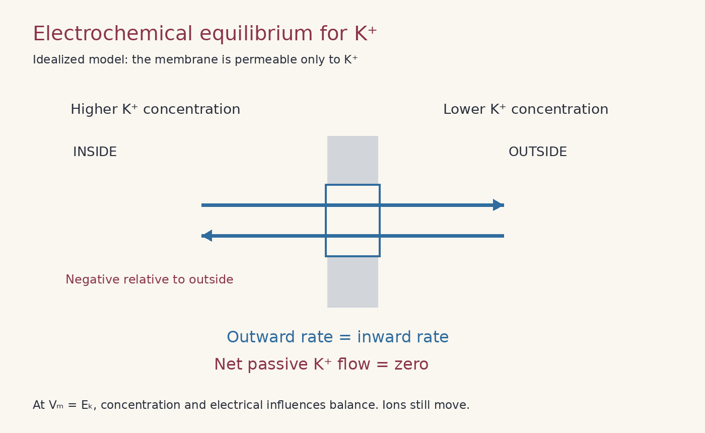

*Modelo idealizado permeável apenas ao K⁺. Um neurônio vivo em repouso é um estado estacionário mantido por vários íons e bombas que consomem energia; seu potencial de repouso não precisa coincidir com o potencial de equilíbrio de um único íon.*

**Nota de edição:** o arquivo-fonte ainda chama esse resumo de “prévia” e diz que não há notas de aula. Como notas foram acrescentadas abaixo, essa indicação deixou de refletir o conteúdo atual; o conceito foi preservado aqui sem classificar esta seção como não estudada.

**Leitura adicional do arquivo-fonte:** [As forças que criam potenciais de membrana](https://www.ncbi.nlm.nih.gov/books/NBK11102/).

**Introdução**

O movimento de íons por canais é guiado pelos efeitos da difusão e da eletrostática e pode modificar o potencial de membrana. Aqui consideramos um único íon: **K⁺**. Vamos investigar como o equilíbrio pode surgir quando apenas ele pode atravessar.

Ao final da atividade, devemos compreender:

1. Como o potencial de membrana muda quando K⁺ sai ou entra?
2. Como os efeitos difusivo e elétrico se relacionam?
3. Quando o fluxo de partículas carregadas atinge o equilíbrio?

**Notas do vídeo 1 — revisadas**

Considere uma membrana separando os compartimentos intracelular e extracelular. O voltímetro tem um eletrodo de referência no exterior e outro no interior, medindo a diferença de tensão entre esses pontos.

Se houver uma separação de cargas que deixe o interior 60 mV abaixo do exterior, reportamos um potencial de membrana de **−60 mV**, pois a referência é externa.

Muitas células do corpo apresentam potenciais de membrana negativos em repouso. As notas mencionam aproximadamente −5 a −100 mV para diferentes células e −40 a −90 mV para neurônios. São faixas ilustrativas, não limites universais.

O líquido de cada lado é aproximadamente **eletroneutro**: no volume da solução, cargas positivas e negativas se compensam quase inteiramente.

O potencial de membrana surge de um pequeno desequilíbrio de cargas muito próximo à membrana. Essa separação cria um campo elétrico e uma diferença de potencial entre os lados. Em termos elétricos, a configuração se comporta parcialmente como um capacitor.

A membrana representada é uma bicamada sem aberturas para os íons. Se houver igual concentração de potássio nos dois lados e nenhuma separação inicial de carga, o que o voltímetro indicará?

**Questão 1**

Qual é o potencial de membrana nesse modelo inicial? **0 mV.**

Agora aumentamos a concentração de K⁺ no interior, mantendo os dois líquidos eletroneutros com quantidades correspondentes de íons negativos. A única mudança é a concentração relativa de potássio; a membrana permanece impermeável.

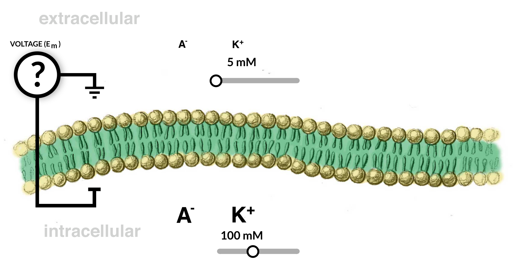

**Questão 2**

Há 5 mM de K⁺ fora e 100 mM dentro, com ânions compensadores A⁻ em ambos os lados. Qual é o potencial nesse modelo? **0 mV.** Alterar a concentração de K⁺ juntamente com suas cargas compensadoras não criou separação inicial de cargas.

**Ajuste conceitual:** uma membrana impermeável pode manter uma tensão se já houver separação de cargas. O resultado de 0 mV depende das condições iniciais deste modelo; impermeabilidade, por si só, não implica tensão zero.

Agora acrescentamos um canal de potássio à membrana.

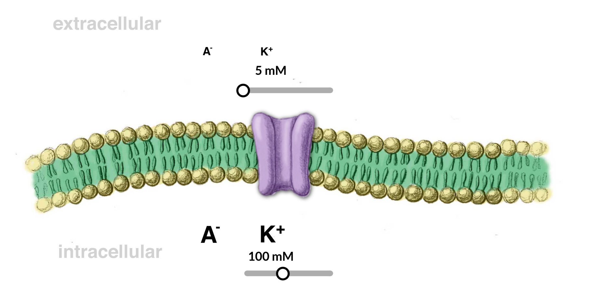

Canais são vias pelas quais íons podem atravessar. O que acontece com K⁺ quando seu canal é aberto?

**Questão 3**

Com 100 mM de K⁺ dentro e 5 mM fora, qual será a direção inicial do fluxo líquido? **Para fora da célula.**

**Esclarecimento da dúvida “o interior está com a carga mais pesada?”:** não é o peso nem uma grande carga líquida interna que explica a saída inicial. É a **maior concentração de K⁺ no interior**, com uma via agora disponível.

**Questão 4**

O que acontece com o potencial quando K⁺ sai? **Ele fica negativo.**

**Esclarecimento da dúvida “isso acontece porque o interior é negativo?”:** o interior torna-se negativo em relação ao exterior porque perde uma pequena quantidade de carga positiva. Essa negatividade passa a se opor à saída adicional de K⁺.

**Notas do vídeo 2 — revisadas**

No começo, cargas negativas compensavam as positivas em ambos os lados. Quando K⁺ sai, deixa um pequeno excesso de carga negativa próximo à face interna da membrana e acrescenta carga positiva próxima à face externa.

O interior fica mais negativo que o exterior. Como definimos a referência externa como zero, o potencial de membrana é negativo.

**Questão 5**

No equilíbrio, como ficam as concentrações de K⁺? **[K⁺]dentro continua maior que [K⁺]fora.** A maior parte do potássio permanece no interior.

**Notas do vídeo 3 — revisadas**

Uma pequena quantidade de K⁺ se difunde para fora, mas sua concentração continua maior dentro. Como K⁺ tem carga elétrica, não basta considerar a difusão.

Em um modelo simples com partículas neutras permeáveis e sem outras influências, a difusão tenderia a igualar as concentrações. Para K⁺, a separação de cargas gera um efeito elétrico adicional: o interior negativo atrai K⁺ e o exterior relativamente positivo o repele. Isso se opõe à saída.

À medida que a separação de cargas cresce, pode chegar um ponto em que o efeito elétrico equilibra a tendência difusiva. As concentrações não precisam se igualar.

As notas usam **−80 mV** como exemplo de potencial de equilíbrio do potássio. Esse valor depende das concentrações e da temperatura, não é uma constante universal.

**Quantos íons precisam se mover?**

A anotação inicial dizia “1 em 100 (??)”. As notas seguintes registram a estimativa da aula: **aproximadamente 1 em 100.000**.

**Notas do vídeo 4 — revisadas**

No exemplo da aula, mover cerca de um em cada 100.000 íons basta para produzir uma tensão de aproximadamente −80 mV.

Dependendo do tamanho da célula, mesmo uma fração minúscula pode corresponder a um grande número absoluto de íons. O ponto principal é a **pequena proporção em relação ao total**.

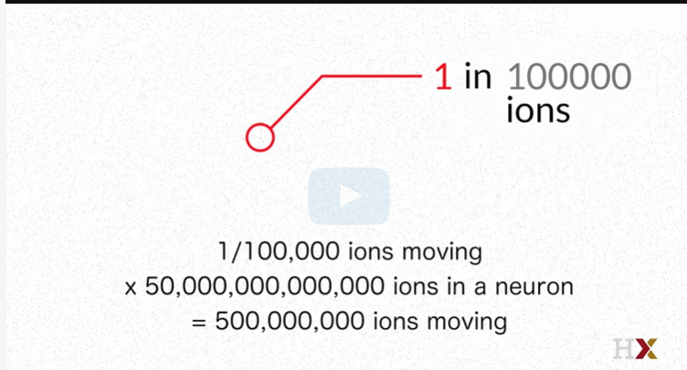

Uma pequena redistribuição de cargas cria um efeito elétrico capaz de contrabalançar a tendência de difusão. Por isso, para muitos cálculos introdutórios, tratamos as concentrações dos compartimentos como praticamente constantes enquanto a tensão se estabelece.

**Ajuste conceitual:** a proporção de 1 em 100.000 é ilustrativa. A fração necessária depende de geometria celular, capacitância da membrana, concentrações e tensão. Não demonstra uma superioridade universal da “força eletrostática sobre a difusão”; mostra que, nessa configuração, uma pequena separação de cargas já produz um efeito elétrico relevante.

**Questão 6**

O que acontece com K⁺ se adicionarmos mais cargas negativas ao exterior, no modelo apresentado? **Mais K⁺ sai.**

**Complemento didático:** essa resposta se refere à perturbação elétrica do modelo. Não é uma regra geral para qualquer adição de um sal eletricamente neutro ao meio externo; é preciso considerar como a intervenção altera tensão e concentrações.

**Questão 7**

Um neurônio tem 15 mM de Cl⁻ dentro e 140 mM fora. Depois do pequeno fluxo necessário para estabelecer o equilíbrio, qual será aproximadamente a concentração interna? **15 mM.**

Basta uma fração muito pequena entrar para criar um efeito elétrico que equilibre a tendência química. As concentrações permanecem quase inalteradas; não se igualam.

**Ligação com a equação de Nernst**

Podemos pensar no gradiente de concentração como uma fonte de energia para o estabelecimento de uma tensão. Para o potencial de equilíbrio, importa a razão entre as concentrações, não somente o número absoluto de íons.

A **equação de Nernst** formaliza essa relação: dadas as concentrações interna e externa, a carga do íon e a temperatura, ela calcula o potencial de equilíbrio desse íon.

Em uma membrana permeável apenas a K⁺, o potencial no equilíbrio pode ser calculado com as concentrações de K⁺. Um neurônio real tem vários íons contribuindo para o potencial de repouso; não podemos, em geral, determinar toda a tensão olhando apenas para o potássio.

##### O potencial de Nernst

**Introdução**

Agora que compreendemos as influências sobre o fluxo de íons e como ele pode modificar o potencial de membrana, podemos usar uma equação formal.

A **equação de Nernst** calcula o potencial em que os efeitos químico e elétrico sobre um íon se equilibram, para determinadas concentrações interna e externa. É uma ferramenta para descrever o comportamento de um íon em condições específicas.

Ao final, devemos responder:

1. Como temperatura e valência afetam o potencial de Nernst?
2. Importam as concentrações absolutas ou relativas? Como alterar as concentrações de K⁺ modifica seu potencial?
3. O que é força motriz e como calculá-la?

Pode ser útil consultar a [folha de fórmulas do curso](https://courses.edx.org/assets/courseware/v1/71475402bce93432b9b909b9180885c1/asset-v1:HarvardX+MCB80.1x+2T2023+type@asset+block/Ref_Sheet_ln_def.pdf).

**Notas do vídeo 1 — revisadas**

Revisando:

- Há íons importantes dentro e fora da célula, separados por uma bicamada lipídica com canais seletivos.
- Ao medir o potencial de repouso, medimos uma diferença de potencial elétrico através da membrana.
- O movimento de íons por seus gradientes pode criar separação de cargas e uma tensão.
- Os líquidos permanecem aproximadamente eletroneutros no seu volume; pouquíssimos íons precisam se redistribuir.
- Para um íon em equilíbrio eletroquímico, as contribuições química e elétrica se equilibram, e o fluxo passivo líquido é zero.

**Ajuste conceitual:** o voltímetro mede diferença de potencial, não um gradiente espacial diretamente nem energia potencial sem dividir pela carga. Também não igualamos numericamente um gradiente de concentração a uma tensão, pois têm unidades diferentes; são seus efeitos eletroquímicos que se compensam.

A equação é:

$$
E_{\text{íon}} = \frac{RT}{zF}
\ln\left(\frac{[\text{íon}]_{\text{fora}}}{[\text{íon}]_{\text{dentro}}}\right)
$$

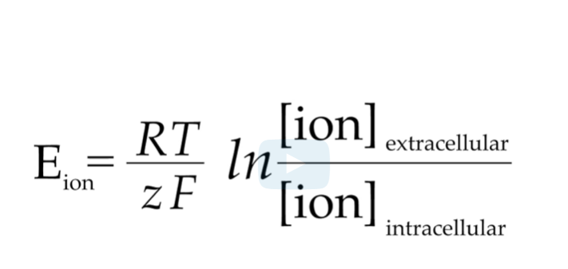

**A variável E e os nomes dos potenciais**

A variável **E**, à esquerda, é o valor que procuramos. Ao resolver a equação para um íon, encontramos o ponto em que seus efeitos químico e elétrico se compensam: o **potencial de Nernst**, também chamado de **potencial de equilíbrio**.

O **potencial de reversão** é a tensão em que a corrente líquida de um canal muda de sentido.

**Ajuste conceitual:** para um canal seletivo a um único íon, o potencial de reversão coincide com o potencial de equilíbrio desse íon. Para um canal permeável a vários íons, o potencial de reversão pode ser diferente dos potenciais de equilíbrio individuais.

> **Para não confundir**
>
> - **Potencial de membrana:** tensão medida entre interior e exterior em um instante.
> - **Potencial de repouso:** potencial de membrana na condição de repouso.
> - **Potencial de Nernst:** tensão de equilíbrio passivo para um único íon.
>
> O potencial de repouso depende de vários íons e da atividade de transportadores. Frequentemente fica próximo ao potencial de equilíbrio de K⁺, mas não precisa ser igual a ele.

**Componentes da equação**

| Símbolo | Significado | Unidade ou exemplo |
|---|---|---|
| Eíon | Potencial de equilíbrio | V, se usadas constantes em unidades SI |
| R | Constante universal dos gases | 8,314 J·mol⁻¹·K⁻¹ |
| T | Temperatura absoluta | K |
| z | Número de carga do íon, com sinal | K⁺: +1; Cl⁻: −1; Ca²⁺: +2 |
| F | Constante de Faraday | 96.485 C·mol⁻¹ |
| [íon]fora | Concentração extracelular | Mesma unidade usada no interior |
| [íon]dentro | Concentração intracelular | Por exemplo, mM |
| ln | Logaritmo natural | Aplicado à razão adimensional |

**Ajustes de tradução:** R é uma constante, não “o gás universal”. A unidade de T é **kelvin (K)**, sem símbolo de grau. Dentro do logaritmo usamos uma **divisão**, fora ÷ dentro, não “fora ou dentro”.

**Em palavras simples:** multiplicamos R pela temperatura absoluta, dividimos por zF e multiplicamos pelo logaritmo natural da razão entre a concentração externa e a interna.

**Questão 1**

O que acontece com Eíon ao mudar de 37 °C para 4 °C, mantendo as concentrações e z?

**Resposta da atividade:** diminui aproximadamente 10%.

**Precisão relevante:** a **magnitude** diminui. Um valor negativo torna-se menos negativo, aproximando-se de zero.

$$
T_1 = 310{,}15\ \mathrm{K},\qquad T_2 = 277{,}15\ \mathrm{K}
$$

$$
\frac{E_2}{E_1}=\frac{277{,}15}{310{,}15}\approx0{,}894
$$

A magnitude cai aproximadamente **10,6%**, arredondados para 10% na atividade.

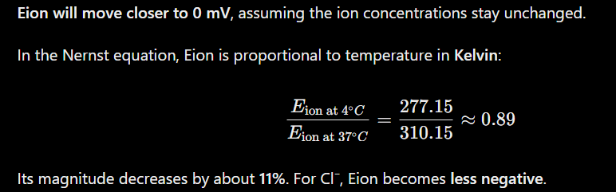

**Notas do vídeo 2 — revisadas**

A temperatura aparece na equação em kelvin. Assim, variações de poucos graus Celsius perto da temperatura corporal representam mudanças proporcionais pequenas em T e no potencial de equilíbrio calculado, se concentrações e carga forem mantidas constantes.

**Ajuste conceitual:** isso não permite concluir que febre ou mudanças de temperatura tenham pouco efeito sobre toda a atividade neuronal. Canais, transporte, metabolismo e dinâmica dos sinais também dependem da temperatura.

O potencial de Nernst também é inversamente proporcional a **z**, mantendo os outros termos constantes.

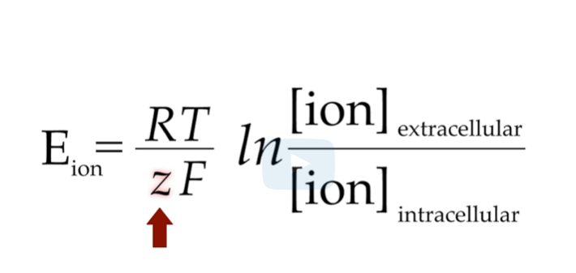

Aqui, “valência” corresponde ao número de carga com sinal:

| Íon | z |
|---|---:|
| Sódio, Na⁺ | +1 |
| Potássio, K⁺ | +1 |
| Cloreto, Cl⁻ | −1 |
| Cálcio, Ca²⁺ | +2 |

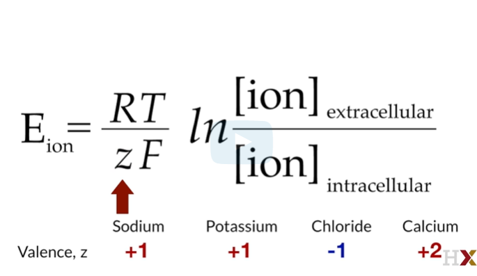

**Questão 2**

Se E(Na⁺) = +60 mV e Cl⁻ tiver as mesmas concentrações interna e externa que Na⁺, qual é E(Cl⁻)? **−60 mV.**

As duas razões de concentração são iguais, mas z muda de +1 para −1. Portanto, o sinal do potencial se inverte.

Na realidade, as concentrações de Cl⁻ não precisam coincidir com as de Na⁺. A aula menciona um potencial de Cl⁻ próximo ao repouso, em torno de −70 mV.

**Precisão:** esse valor varia entre neurônios e condições. Guarde a ideia de que E(Cl⁻) pode estar próximo ao repouso; não memorize −70 mV como constante universal.

**Atividade sobre concentrações**

A simulação da aula mostra concentrações de K⁺ dentro e fora e o potencial correspondente. Explore como alterações nas concentrações modificam Eₖ. Tente encontrar pelo menos dois pares de concentrações que produzam **−50 mV**, mantendo a temperatura constante.

**Complemento didático:** se um par produz −50 mV, multiplicar ambas as concentrações pelo mesmo fator mantém a razão e o potencial.

**Notas do vídeo 3 — revisadas**

Importa a **razão entre as concentrações externa e interna**, não seus valores absolutos isoladamente. Isso aparece diretamente no termo fora ÷ dentro da equação.

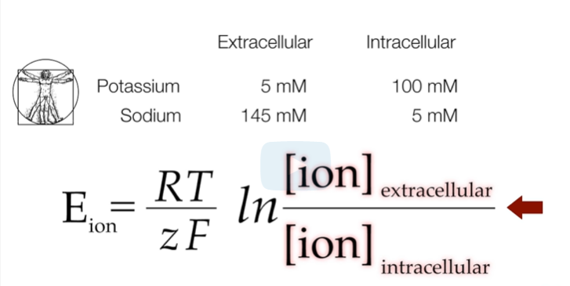

No exemplo da aula, neurônios de lula apresentam aproximadamente:

- **K⁺:** 20 mM fora e 400 mM dentro.
- **Na⁺:** 440 mM fora e 12 mM dentro.

As notas comparam essas concentrações às humanas, com valores de K⁺ cerca de quatro vezes maiores no exemplo. A ideia central é que ambientes e concentrações absolutas podem diferir bastante, mas razões semelhantes produzem potenciais semelhantes, para o mesmo íon à mesma temperatura.

A relação com a vida em água salgada aparece nas notas como uma hipótese explicativa, não como algo demonstrado pelo cálculo.

**Ajuste conceitual:** não é adequado aplicar o mesmo fator “três vezes” a todas as concentrações de Na⁺ sem especificar a referência humana. Compare as razões efetivas e a temperatura.

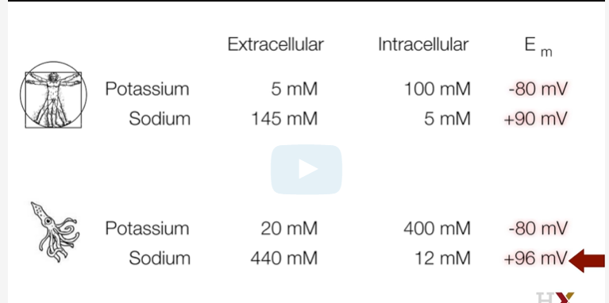

A tabela da aula apresenta concentrações fisiológicas e potenciais de Nernst a 37 °C. Embora o cálcio extracelular esteja em torno de **2 mM**, seu potencial pode estar próximo de **+123 mV**.

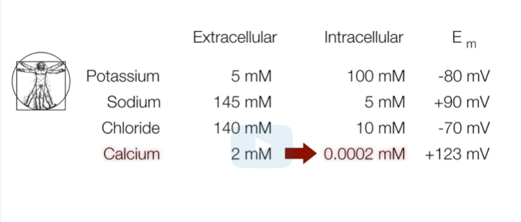

Isso ocorre porque o **cálcio livre intracelular** está em concentração muito menor: a razão fora ÷ dentro é grande. O cálcio participa de muitas vias de sinalização, e a célula regula rigorosamente sua concentração livre.

**Força motriz — driving force**

Em termos simples, a força motriz indica a distância elétrica entre a tensão atual da membrana e o ponto de equilíbrio de um íon.

Formalmente:

$$\text{Força motriz} = V_m - E_{\text{íon}}$$

Ela é expressa em **mV**, não em newtons.

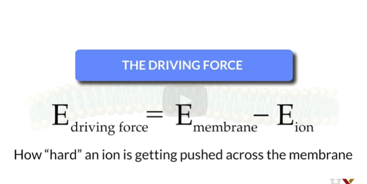

**Ajuste de redação:** a palavra “ferro” nas notas é um erro de transcrição; o conceito é o **íon** sendo impulsionado através da membrana. “O íon quer entrar” é apenas uma maneira informal de falar: íons não têm intenção.

**Exemplo com cálcio e potássio**

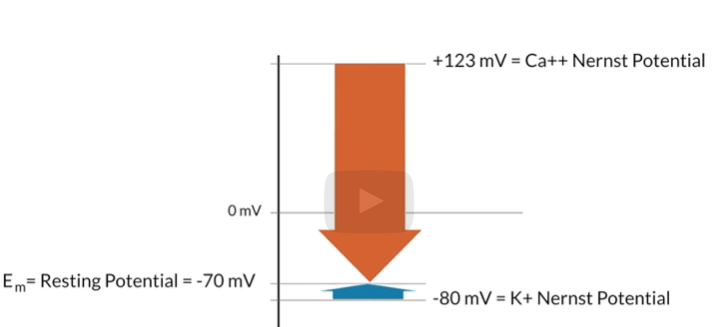

Considere:

- Vₘ = −70 mV.
- E(Ca²⁺) ≈ +120 mV.
- Eₖ ≈ −80 mV.

Então:

$$
V_m-E_{\mathrm{Ca}}=-70-(+120)=-190\ \mathrm{mV}
$$

$$
V_m-E_{\mathrm K}=-70-(-80)=+10\ \mathrm{mV}
$$

A força motriz do cálcio favorece fortemente sua entrada quando houver canais adequados abertos. A entrada de carga positiva tende a tornar o interior mais positivo, aproximando Vₘ de E(Ca²⁺).

Para K⁺, nessas condições, o fluxo líquido é para fora.

**Correções relevantes:** o íon é **Ca²⁺**, não Ca⁺. Com os valores citados, a força motriz é **−190 mV**; −200 mV seria apenas uma aproximação grosseira.

**Complemento didático:** força motriz não determina sozinha a corrente. Importam a quantidade de canais abertos e sua condutância. Em um modelo simples:

$$I_{\text{íon}}=g_{\text{íon}}(V_m-E_{\text{íon}})$$

Para cátions, força motriz positiva favorece saída, e negativa favorece entrada. Para Cl⁻, a direção do movimento dos íons é oposta à direção da corrente convencional.

**Questão 3**

Há canais para Na⁺ e K⁺, e Vₘ = −70 mV. Como ocorre o fluxo, usando os potenciais do exemplo? **Na⁺ entra e K⁺ sai.**

**Questão 4**

O que afeta o potencial de Nernst de K⁺? **As concentrações interna e externa de K⁺ e a temperatura.** Para o mesmo íon, z permanece fixo em +1.

**Questão 5**

Eₖ = −80 mV. Se Mg²⁺ tiver exatamente as mesmas concentrações interna e externa, à mesma temperatura, qual será seu potencial? **−40 mV.**

A razão é igual, mas z passa de +1 para +2; portanto, o potencial fica dividido por dois. É um cenário hipotético, não uma afirmação sobre a distribuição real de Mg²⁺.

**Questão 6**

Há 15 mM de Cl⁻ dentro e 140 mM fora. O potencial de equilíbrio será positivo ou negativo? **Negativo.**

No modelo inicialmente sem tensão, a difusão favorece a entrada de Cl⁻. A entrada de carga negativa torna o interior mais negativo em relação ao exterior, criando uma influência elétrica que se opõe à entrada adicional. No equilíbrio, os efeitos se compensam.

Pela equação: a razão fora ÷ dentro é maior que 1, então ln é positivo; como z = −1, o resultado é negativo.

##### Resolução de problemas com o potencial de Nernst

O potencial de Nernst representa o ponto de equilíbrio de um único íon: a tensão de membrana em que seus efeitos químico e elétrico se compensam.

Nesta seção, vamos nos familiarizar com a equação, tanto em seu significado teórico quanto em sua aplicação a problemas de movimento iônico.

Ao final, devemos conseguir:

1. Calcular o potencial de Nernst com segurança.
2. Prever a direção do fluxo de um íon a partir de seu potencial de equilíbrio e do potencial de membrana atual.

**Diferentes “potenciais”**

Vamos esclarecer os termos:

1. **Potencial de membrana:** tensão através da membrana em qualquer instante.
2. **Potencial de Nernst:** tensão em que um único íon está em equilíbrio eletroquímico, dadas a temperatura e a razão de concentrações.
3. **Potencial de repouso:** tensão relativamente estável que resulta da atuação de vários íons e transportadores. Dizemos que o neurônio está em repouso quando está nessa condição basal.
4. **Despolarização:** mudança que torna o potencial mais positivo; nos exemplos próximos ao repouso, menos negativo.
5. **Hiperpolarização:** mudança que torna o potencial mais negativo.

**Exemplo didático:** −70 → −50 mV é uma despolarização; −70 → −90 mV é uma hiperpolarização.

**Concentrações iônicas**

Como vimos, o movimento de íons devido a gradientes pode estabelecer uma tensão através da membrana. O acúmulo de uma pequena quantidade de cargas de sinais opostos nas faces da membrana sustenta essa diferença de potencial.

Para compreender mais profundamente o potencial de Nernst, vamos observar como as concentrações de um íon afetam o resultado. Podemos chegar às mesmas conclusões substituindo os números na equação.

Considere três situações:

1. 100 mM de K⁺ dentro e 10 mM fora.
2. 10 mM de K⁺ dentro e 100 mM fora.
3. 100 mM de K⁺ dentro e 40 mM fora.

**Cenário 1 — 100 mM dentro e 10 mM fora**

Essas concentrações são semelhantes às usadas em exemplos fisiológicos. Lembre que o potencial de Nernst é o ponto em que os efeitos químico e elétrico se equilibram.

Partindo de um modelo sem tensão, a difusão favorece a saída de K⁺. Isso deixa um pequeno excesso de carga positiva perto da face externa e negativa perto da face interna. O efeito elétrico passa, então, a favorecer K⁺ de volta para dentro.

O potencial de equilíbrio será **negativo**, porque é preciso um interior negativo para equilibrar a tendência de saída por difusão.

A referência da medida continua sendo o exterior.

**Cenário 2 — 10 mM dentro e 100 mM fora**

É o inverso do cenário anterior. A difusão favorece a entrada de K⁺. O acúmulo de carga positiva no interior e negativa no exterior cria um efeito elétrico que se opõe à entrada.

Portanto, o potencial de equilíbrio será **positivo**.

**Cenário 3 — 100 mM dentro e 40 mM fora**

A difusão ainda favorece a saída, e o efeito elétrico no equilíbrio favorece a entrada. Porém, a diferença relativa de concentrações é menor que no cenário 1.

É preciso uma tensão negativa de menor magnitude para contrabalançar essa tendência. Logo, o potencial será **menos negativo** que no cenário 1.

**Complemento didático — comparação numérica a 37 °C**

Usando RT/F ≈ 26,73 mV para K⁺:

| Cenário | K⁺ dentro | K⁺ fora | Razão fora/dentro | Eₖ aproximado |
|---|---:|---:|---:|---:|
| 1 | 100 mM | 10 mM | 0,1 | −61,5 mV |
| 2 | 10 mM | 100 mM | 10 | +61,5 mV |
| 3 | 100 mM | 40 mM | 0,4 | −24,5 mV |

Esses números complementam a explicação qualitativa da aula. A relação depende do **logaritmo da razão**, não simplesmente da diferença aritmética entre concentrações.

**Direção do fluxo iônico**

Agora sabemos como as concentrações determinam o potencial de equilíbrio. Precisamos enfatizar que ele é um ponto de equilíbrio **para o íon considerado**.

Para passagem passiva por canais, podemos usar a regra:

> **O fluxo líquido de um íon tende a modificar a tensão da membrana na direção de seu próprio potencial de equilíbrio.**

**Precisão conceitual:** a regra descreve o efeito da corrente passiva desse íon sobre a tensão. A tensão real também depende de outras correntes; em uma fixação de voltagem, o equipamento pode mantê-la constante. Bombas e transportadores acoplados exigem análise própria. Não significa que toda travessia de íons, em qualquer mecanismo, obedece a essa regra simples.

Considere Eₖ = −80 mV e três valores de Vₘ:

1. −40 mV.
2. −80 mV.
3. −120 mV.

**Cenário 1 — Vₘ = −40 mV**

O potencial atual é mais positivo que Eₖ, pois −40 > −80. O fluxo passivo de K⁺ será para fora. A saída de carga positiva tende a tornar o interior mais negativo, aproximando Vₘ de −80 mV.

**Cenário 2 — Vₘ = −80 mV**

Vₘ é igual a Eₖ: K⁺ está em equilíbrio eletroquímico. Não há fluxo passivo **líquido** em nenhuma direção. Ainda pode haver movimentos individuais em ambos os sentidos.

**Cenário 3 — Vₘ = −120 mV**

Vₘ é mais negativo que Eₖ. K⁺ entra, trazendo carga positiva e tendendo a tornar o interior mais positivo, mais próximo de −80 mV.

**Tradução mental**

O potencial de equilíbrio é o “ponto de balanço” de um íon. Compare a tensão atual com esse ponto e pergunte: **a entrada ou a saída desse íon traz a carga necessária para aproximar a tensão do equilíbrio?**

**Exemplo de cálculo**

Agora voltamos ao cálculo explícito. O potencial depende da razão de concentrações, da temperatura e do número de carga do íon.

No exemplo:

- [K⁺]fora = **10 mM**.
- [K⁺]dentro = **150 mM**.
- Temperatura = **37 °C**.

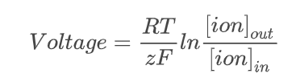

A equação é:

$$
E_K=\frac{RT}{zF}\ln\left(\frac{[K^+]_{\text{fora}}}{[K^+]_{\text{dentro}}}\right)
$$

Usamos:

- **T = 37 + 273,15 = 310,15 K**.
- **z = +1** para K⁺; para Cl⁻ seria −1 e para Ca²⁺, +2.
- **R = 8,314 J·mol⁻¹·K⁻¹**.
- **F = 96.485 C·mol⁻¹**.

**Ajuste de unidade:** a conversão correta é T(K) = t(°C) + 273,15. A escrita do original “37 + 273 °C = 310 Kelvin” mistura unidades; 310 K é uma aproximação da temperatura absoluta, não 310 °C.

Como RT/F ≈ 0,02673 V a 37 °C:

$$
E_K \approx 0{,}02673\ln(10/150)\ \mathrm{V}
$$

$$
E_K \approx -0{,}0724\ \mathrm{V}\approx -72{,}4\ \mathrm{mV}
$$

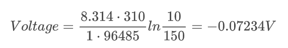

A equação, com essas unidades de R e F, fornece o resultado em **volts**. Multiplicamos por 1.000 para obter **milivolts**.

A aula registra **−72,34 mV**, compatível com o uso de aproximadamente 310 K e os arredondamentos das constantes.

**Questão 1 — K⁺ em DMEM**

Em laboratório, cientistas frequentemente estudam neurônios isolados, em recipientes de cultura. Nesse ambiente, é possível controlar a composição da solução ao redor da célula: o **meio de cultura**. É como substituir o líquido extracelular habitual por outra solução.

Existem meios para diferentes finalidades. Aqui comparamos o **Dulbecco’s Modified Eagle’s Medium (DMEM)** e um **meio despolarizante**.

A tabela da aula apresenta as concentrações abaixo, todas em **mM**:

| Íon | Intracelular | DMEM | Meio despolarizante |
|---|---:|---:|---:|
| K⁺ | 140 | 5,3 | 55 |
| Na⁺ | 10 | 154 | 105 |
| Cl⁻ | 12 | 119 | 119 |
| Ca²⁺ | 0,0001 | 1,8 | 1,8 |

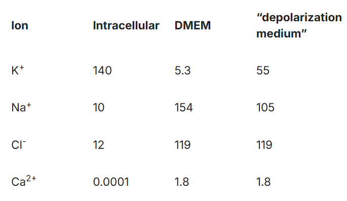

**Ajuste editorial:** o arquivo-fonte aponta novamente para a imagem 02 neste ponto, mas a tabela de concentrações está na **imagem 03**, cuja existência e conteúdo foram conferidos. A referência foi corrigida nesta tradução.

Qual é Eₖ para esse neurônio em DMEM a 37 °C? **Aproximadamente −87 mV.**

**Nota pessoal preservada:** “Fiz a conta, mas acho que fiz errado. Corrigir.”

**Correção de cálculo — passo a passo**

A tentativa original usou 8314 para R, 37 para T e levantou a dúvida de usar 55 mM como concentração externa. Os pontos a corrigir são:

1. **R = 8,314**, com vírgula decimal, e não 8.314 como número de milhares.
2. **T = 310,15 K**, não 37.
3. Para **DMEM**, [K⁺]fora = **5,3 mM**. Os **55 mM** pertencem ao meio despolarizante.
4. A razão é **fora ÷ dentro**.
5. O logaritmo de uma razão entre 0 e 1 é **negativo**.
6. Com R e F nas unidades acima, o resultado inicialmente é em **V**.

Calculando:

$$
RT=8{,}314\times310{,}15\approx2578{,}6\ \mathrm{J\,mol^{-1}}
$$

$$
zF=1\times96485=96485\ \mathrm{C\,mol^{-1}}
$$

$$
\frac{RT}{zF}\approx0{,}026725\ \mathrm{V}=26{,}725\ \mathrm{mV}
$$

$$
\frac{[K^+]_{\text{fora}}}{[K^+]_{\text{dentro}}}
=\frac{5{,}3}{140}\approx0{,}03786
$$

$$
\ln(0{,}03786)\approx-3{,}274
$$

$$
E_K\approx26{,}725\times(-3{,}274)\ \mathrm{mV}
\approx-87{,}5\ \mathrm{mV}
$$

O valor da atividade, **−87 mV**, representa a aproximação adotada no material.

**Em palavras simples:** primeiro calcule o fator da temperatura, depois a razão externa/interna, depois seu logaritmo. Por fim, multiplique os termos e confira o sinal.

**Questão 2 — Cl⁻ em DMEM**

Qual é o potencial de Nernst de Cl⁻ a 37 °C? **Aproximadamente −61 mV.**

**Cálculo complementar:**

$$
E_{\mathrm{Cl}}\approx
\frac{26{,}725}{-1}
\ln\left(\frac{119}{12}\right)\ \mathrm{mV}
\approx-61{,}3\ \mathrm{mV}
$$

A razão é maior que 1 e seu logaritmo é positivo. O sinal negativo vem de z = −1.

**Questão 3 — K⁺ no meio despolarizante**

Qual é Eₖ nesse meio a 37 °C? **Aproximadamente −25 mV.**

**Cálculo complementar:**

$$
E_K\approx26{,}725\ln\left(\frac{55}{140}\right)\ \mathrm{mV}
\approx-25{,}0\ \mathrm{mV}
$$

**Tradução mental:** aumentar K⁺ no exterior, mantendo a concentração interna maior e constante, aumenta a razão fora/dentro e a aproxima de 1. O potencial de equilíbrio do potássio fica menos negativo. Se K⁺ tiver influência importante sobre Vₘ, essa mudança pode despolarizar a célula.

**Questão 4 — menor força motriz a −100 mV**

Com o neurônio em DMEM a 37 °C, qual íon tem a menor força motriz em magnitude quando aplicamos Vₘ = −100 mV?

**Resposta: K⁺.**

A temperatura é aproximadamente 310 K e RT/F ≈ 26,7 mV. As concentrações internas ficam iguais entre os dois meios; as externas dependem do meio escolhido.

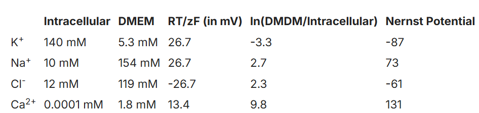

Usando os valores arredondados da tabela da aula:

| Íon | Eíon em DMEM | Vₘ − Eíon a −100 mV | Magnitude |
|---|---:|---:|---:|
| K⁺ | −87 mV | −13 mV | 13 mV |
| Na⁺ | +73 mV | −173 mV | 173 mV |
| Cl⁻ | −61 mV | −39 mV | 39 mV |
| Ca²⁺ | +131 mV | −231 mV | 231 mV |

K⁺ tem o potencial de equilíbrio mais próximo de −100 mV e, portanto, a menor **magnitude** de força motriz.

**Precisão:** aqui “menor” significa menor valor absoluto. O número −231 é numericamente menor que −13, mas representa uma força motriz de maior magnitude.

**Questão 5 — direção do fluxo desse íon**

Em que sentido ocorre o fluxo líquido de K⁺? **Do exterior para o interior.**

Com Vₘ = −100 mV e Eₖ ≈ −87 mV, o interior está mais negativo que o ponto de equilíbrio de K⁺. A entrada de K⁺ traz carga positiva e tende a aproximar a tensão de −87 mV.

**Complemento didático:** se o experimento mantiver Vₘ fixo em −100 mV, o equipamento compensará essa corrente. Ainda assim, a direção do fluxo passivo de K⁺ será para dentro enquanto essas condições forem mantidas.

**Questão 6 — direção do fluxo de Cl⁻**

O potencial de membrana está em −30 mV e E(Cl⁻) = −60 mV. Se houver canais disponíveis, em que sentido ocorre o fluxo líquido de Cl⁻? **Para dentro da célula.**

Entrar com carga negativa tende a tornar o interior mais negativo, aproximando Vₘ de −60 mV.

**Complemento didático:** Vₘ − E(Cl⁻) = +30 mV. Para Cl⁻, esse sinal corresponde à corrente convencional para fora, mas ao movimento de íons negativos **para dentro**. Distinguir corrente de movimento iônico evita inverter a resposta.

---

##### A equação de GHK — PAREI AQUI

**Próximo tópico; ainda não estudado no arquivo-fonte.** Nenhum conteúdo de aula foi acrescentado além deste marcador.

---

## Referências e registro dos ajustes

As imagens, perguntas e notas desta tradução correspondem ao material existente no arquivo-fonte. As referências adicionais já presentes nele foram mantidas em seus respectivos tópicos.

**Referência externa consultada para conferir os esclarecimentos:** [Neuroscience Online — Resting Potentials and Action Potentials, McGovern Medical School / UTHealth](https://nba.uth.tmc.edu/neuroscience/s1/chapter01.html), especialmente as seções sobre registro intracelular e mecanismos iônicos do potencial de repouso.

**Principais ajustes desta versão:**

- Diferenciar tensão, energia potencial e gradiente elétrico.
- Distinguir a quase eletroneutralidade do líquido da pequena separação de cargas próxima à membrana.
- Tratar os valores de repouso, Eₖ e fração de íons deslocados como exemplos dependentes das condições.
- Diferenciar equilíbrio de um íon de estado estacionário de um neurônio em repouso.
- Restringir a equivalência entre reversão e Nernst ao caso de canal seletivo a um único íon.
- Usar kelvin, R = 8,314 J·mol⁻¹·K⁻¹, a razão fora/dentro e a conversão de V para mV.
- Corrigir Ca⁺ para Ca²⁺ e a força motriz de cálcio do exemplo para −190 mV.
- Explicar que a mudança de temperatura calcula uma alteração de magnitude do potencial; não é conclusão geral sobre febre ou funcionamento neuronal.
- Corrigir o exercício de K⁺ em DMEM com **5,3 mM fora**, em vez dos **55 mM do meio despolarizante**.
- Corrigir a referência da tabela de concentrações para a imagem 03.
- Preservar dúvidas e intenção das notas, com as respostas e os complementos identificados.

<!-- maintenance: atualizar os trechos correspondentes quando o arquivo-fonte mudar; preservar futuras anotações manuais da usuária neste arquivo. -->
